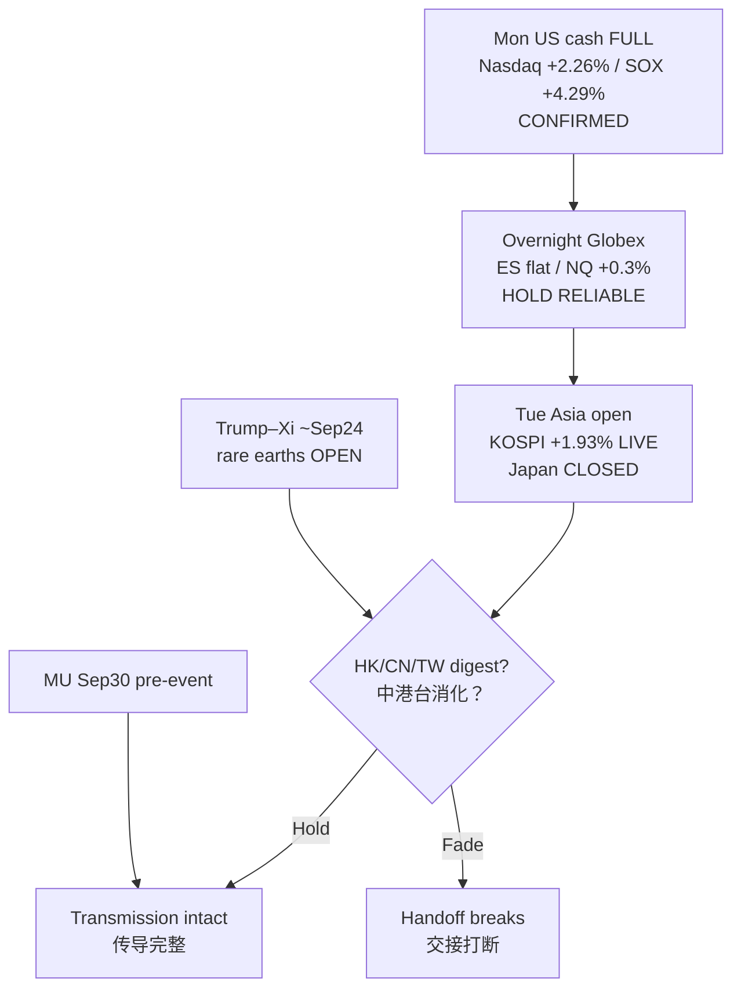

# AI Factory Daily Market Report / AI 工厂每日市场报告

**Session / 时段:** Morning / 早盘  
**Timestamp / 时间戳:** 2026-09-22 08:45 MYT (Asia/Kuala_Lumpur)  
**Market mood / 市场情绪:** **Mon US cash FULL session CONFIRMED and EXTENDED** the Asia+Globex tech bid — Nasdaq **record close** **27,122.09 (+2.26%)**, S&P **7,764.70 (+1.49%)**, Dow **52,048.83 (+0.71%)**, SOX **12,433.17 (+4.29%)**, QQQ **741.47 (+2.88%)**; overnight Globex **HELD** (ES ~**7,833** flat / NQ ~**30,877 +0.3%** vs Mon futures settle); Tue Asia = **KOSPI LIVE ~7,143 (+1.93%)** continuation + **Japan cash CLOSED** (bridge holiday) · **周一美股现金完整会话确认并强化**亚洲+期货科技偏多——纳指**创纪录收盘**；隔夜期货**守住**；周二亚洲以**韩股实时续涨**+**日本现货休市**为主

---

## 0. Header notes / 页眉说明

- **Calendar / 假日 (CONFIRMED JPX calendars):** **Japan TSE cash CLOSED** Tue Sep 22 (statutory bridge holiday between Respect for the Aged Day and Autumnal Equinox) and **Wed Sep 23** (Autumnal Equinox). OSE/TOCOM **derivatives holiday trading** open Sep 21–23. Cash equity resumes **Thu Sep 24**. **Korea Chuseok closes Sep 24–25** (liquidity risk into week). **China Mid-Autumn Sep 25**. Korea / China / HK / Malaysia / Taiwan / US / major Europe = OPEN today (HK/CN ~09:30 MYT; MY/TW ~09:00).  
- **US cash (PRIMARY update vs Mon evening EARLY):** Full Mon session **CONFIRMED** evening early thesis and **extended** — Dow **52,048.83 (+0.71%)**, S&P **7,764.70 (+1.49%)**, Nasdaq **27,122.09 (+2.26%)** (record close; first since Jun 2 per Reuters), RUT **2,875.36 (+0.52%)**, SOX **12,433.17 (+4.29%)**, QQQ **741.47 (+2.88%)**, VIX **14.87 (+0.41%)**. Evening early (~21:55 MYT) was only a partial print; full session was **stronger** in tech/semis.  
- **Overnight Globex → Tue Asia (PRIMARY tape):** Futures **held** Mon settle rather than mean-reverting hard — ES **~7,833.25 (−0.003%)**, NQ **~30,876.5 (+0.30%)**, YM **~52,417 (−0.11%)**, RTY **~2,897.4 (flat)** vs Mon futures previousClose (Yahoo ~08:45 MYT). Hypothesis from evening (“ARM/INTC cascade / Globex gap-down”) = **not firing so far**.  
- **Asia Tue morning labels:** **KOSPI LIVE ~7,142.68 (+1.93%)** vs Mon close **7,007.72** (Yahoo; also CNBC ~7,141). **Nikkei = Fri close LOCKED 65,018.95** (holiday). **HSI 25,042.71 / SSE 3,949.91 / CSI 300 4,539.57 / TWSE 47,718.84 / FBM KLCI 1,666.94** = **Mon closes** at this ~08:45 MYT stamp (HK/CN ~09:30; MY/TW ~09:00 opens pending).  
- **Oil / rates / FX overnight:** Mon settles (wires): WTI Oct **$95.78 (−4.51%)**, Brent Nov **$100.34 (−3.40%)**. Overnight Yahoo continuous: CL=F **~92.62** / BZ=F **~96.52** (contract/continuous may differ from named settles — labeled separately). 10Y **~4.95–4.96%** (CNBC US10Y **4.951%**; Yahoo ^TNX **4.963%** Mon). USD/JPY **~157.30**. DXY **~100.38**.  
- **Watchlist Mon closes (Nasdaq API):** **ARM $322.90 (+17.16%)**, **INTC $121.78 (+12.14%)**, **QCOM $194.23 (+9.29%)**, **MRVL $257.38 (+5.38%)**, **CRWV $85.43 (+5.00%)**, **TSLA $375.21 (+3.00%)**, **MU $1,043.96 (+2.77%)**, **LITE $954.49 (+2.53%)**, **NVDA $227.38 (+2.30%)**, **AVGO $362.66 (+1.60%)**, **AAPL $338.98 (+0.85%)**, **SPCX $151.85 (−0.56%)**. META **$741.25 (+11.43%)** / AMD **$615.52 (+9.95%)** cited as session narrative peers (not core watchlist).  
- **Catalyst stack LIVE:** Bessent–He “successful” optics → **Trump–Xi ~Sep 24** (rare earths / Nov 10 truce still **OPEN** — Reuters Sep 21); Starship Flight 14 **NET ~Sep 28** (TENTATIVE); **MU FY2026 Q4 Wed Sep 30**; Fed path SEP **4.1/4.1** residual OPEN; thin US data week → summit / UNGA / Fedspeak dominate.  
- **Sources:** Yahoo Finance v8 (~08:44–08:46 MYT), Nasdaq quote API (Mon closes + AH), CNBC quote cache (cash indices, KOSPI live, FX/yields ~08:44 MYT), AP/Reuters/MarketScreener Mon wrap, FinancialJuice/MarketWatch oil settles, JPX holiday calendars, Newsquawk Asia-Pac Opening 22 Sep, Mon evening report continuity. Unverified = `N/A (unverified)`.  
- **SPCX:** Nasdaq-listed Space Exploration Technologies Corp. (SpaceX｜太空探索技术公司), first trade **2026-06-12** (**CONFIRMED**). **CRWV:** public CoreWeave.

- **假日：** **日本现货休市**（夹在中间的法定休日 + 秋分）；衍生品假期交易仍开。韩国中秋 **9/24–25**；中国中秋 **9/25**。  
- **美股现金：** 周一完整会话**确认并强化**晚间早盘论点（纳指纪录收盘、SOX +4.3%）。  
- **隔夜→周二：** 期货相对周一结算**守住**；韩股实时续涨；日经锁定；中港台马约 08:45 仍多为周一收盘/待开。  
- **催化：** 特习约 **9/24**（稀土未解）；星舰约 **9/28**；美光 **9/30**。

---

## 1. Market snapshot / 市场速览

### Compact tape / 速览表

| Asset / 资产 | Last / 最新 | 1D% / 日涨跌 | Note / 备注 |
|---|---:|---:|---|
| Dow Jones | 52,048.83 | +0.71% | **Mon full close** (AP/CNBC) |
| S&P 500 | 7,764.70 | +1.49% | **Mon full close** — within ~0.4% of Aug 13 record |
| Nasdaq Composite | 27,122.09 | +2.26% | **Mon full close — record** |
| Nasdaq-100 / QQQ | QQQ 741.47 | +2.88% | **Mon close** (Nasdaq API) |
| Dow futures (YM) | 52,417 | −0.11% vs Mon fut settle | **Overnight Globex** Yahoo ~08:45 |
| S&P futures (ES) | 7,833.25 | −0.003% vs Mon fut settle | **Overnight HOLD** |
| Nasdaq-100 futures (NQ) | 30,876.5 | +0.30% | **Overnight mild bid** |
| Russell 2000 futures (RTY) | 2,897.4 | 0.00% | Flat overnight |
| SOX (PHLX Semi｜费城半导体指数) | 12,433.17 | +4.29% | **Mon close** (CNBC/Yahoo) |
| Russell 2000 | 2,875.36 | +0.52% | **Mon close** |
| QQQ | 741.47 | +2.88% | Mon close |
| VIX | 14.87 | +0.41% | Mon close — still soft |
| JNK | 94.71 | +0.17% | Mon/AH Yahoo |
| NBI (Biotech｜生物科技指数) | 7,047.44 | +1.10% | Mon close |
| Brent (BZ=F continuous) | 96.52 | +0.29% vs prior bar | **Overnight Yahoo** — see Mon settle note |
| WTI (CL=F continuous) | 92.62 | +0.27% | **Overnight Yahoo** |
| Brent Nov settle (Mon) | 100.34 | −3.40% | **Mon ICE settle** (wires) |
| WTI Oct settle (Mon) | 95.78 | −4.51% | **Mon NYMEX settle** (wires) |
| US 2Y (proxy ^IRX / CNBC US2Y) | CNBC **4.751%** / ^IRX **3.982%** | mixed proxies | Bill vs note — labeled |
| US 5Y yield (^FVX) | 4.834% | −0.45% (Yahoo bar) | Mon |
| US 10Y yield | ~4.95–4.96% | eased vs Fri ~5.00% | CNBC **4.951%** / Yahoo ^TNX **4.963%** |
| US 20Y yield | N/A (unverified) | N/A (unverified) | Exact print not fetched |
| US 30Y yield (^TYX / CNBC) | ~5.28–5.30% | eased | Yahoo **5.296%** / CNBC **5.28%** |
| DXY | 100.38 | −0.05% | Overnight Yahoo/CNBC |
| XAUUSD / Gold | GC=F 4,392.3 / spot XAU ~4,351 | +0.19–0.26% | Soft-to-flat overnight |
| XAGUSD / Silver | SI=F 66.90 / spot ~66.42 | +0.6–0.7% | Firm |
| London Gold | N/A (unverified) | N/A (unverified) | Futures/spot used as proxy |
| SSE Composite | 3,949.91 | +0.97% Mon | **Mon close** — Tue open ~09:30 pending |
| CSI 300 | 4,539.57 | +0.71% Mon | **Mon close** |
| FBM KLCI | 1,666.94 | +0.08% Mon | **Mon close** — Tue ~09:00 pending |
| KOSPI | 7,142.68 | +1.93% | **Tue LIVE** vs Mon 7,007.72 |
| Nikkei 225 | 65,018.95 | +1.38% Fri | **HOLIDAY — Fri LOCKED** |
| Hang Seng | 25,042.71 | +1.18% Mon | **Mon close** — Tue ~09:30 pending |
| TWSE / Taipei | 47,718.84 | +1.14% Mon | **Mon close** — Tue ~09:00 pending |
| DAX | 25,575.01 | +1.07% | **Mon Europe close** |
| USD/JPY | 157.30 | ~flat overnight | Japan participants thin |
| USD/SGD | 1.2758 | mild SGD soft | Yahoo |
| USD/TWD | 31.73 | mild TWD soft | Yahoo |
| USD/MYR | 4.074 | ~flat | Yahoo |
| USD/KRW | 1,363.9 | KRW firmer vs Mon | Yahoo −0.86% bar |
| GBP/USD | 1.3375 | mild | Yahoo |
| EUR/USD | 1.1473 | mild | Yahoo |
| AUD/USD | 0.7127 | mild | Yahoo |
| USD/CNY | 6.6845 | CNY firmer | Yahoo |
| MYR/JPY | ~38.61 | N/A (calc) | 157.30/4.074 |
| MYR/KRW | ~334.8 | N/A (calc) | Derived |
| MYR/CNY | ~1.641 | N/A (calc) | Derived |
| MYR/THB | N/A (unverified) | N/A (unverified) | USD/THB not fetched |
| SGD/MYR | ~3.193 | N/A (calc) | 4.074/1.2758 |
| BTC | ~86,318 | Mon ~+6% then mild AH soft | Yahoo/CNBC Coinbase |
| ETH | ~2,771 | Mon strong / overnight mild soft | Yahoo |

### Tape read / 盘面解读

1. **Mon full cash = CONFIRM + EXTEND (Fact):** Evening early Nasdaq +1.19% / SOX +2.25% → full close Nasdaq **+2.26% record** / SOX **+4.29%**. / **周一完整现金=确认并强化。**  
2. **Overnight Globex HOLD (Fact):** ES flat / NQ +0.3% vs Mon futures settle — mean-reversion cascade **not** the opening print. / **隔夜期货守住——剧烈均值回归未成为开盘事实。**  
3. **KOSPI LIVE continuation (Fact):** ~**7,143 (+1.93%)** carries Mon chip cue into Tue; Japan holiday still thins regional beta. / **韩股实时续涨；日本休市仍稀释区域贝塔。**  
4. **Oil relief held (Fact):** Mon settles deep; overnight continuous still soft — inflation optics easier at the margin, geopolitics residual. / **油价缓和仍在，地缘残差仍在。**  
5. **Summit week overhang (Fact + Expectation):** Trump–Xi ~Sep 24 LIVE; rare earths unresolved; Nov 10 truce cliff unchanged. / **峰会周阴影仍在。**

**What this means / 这说明什么:**  
Morning spine = **(1) Mon US cash fully validated Asia+Globex tech bid, (2) overnight did not break the handoff, (3) Korea carries continuation while Japan is closed, (4) Trump–Xi ~Sep 24 + MU Sep 30 are the next hard hinges**. Do **not** read SOX +4.3% as Fed-path absolution (SEP 4.1/4.1 still OPEN).  
早盘主线 = **（1）周一现金完整验证科技偏多，（2）隔夜未打断交接，（3）韩股续涨而日本休市，（4）特习约9/24与美光9/30为下一硬枢纽**。勿把 SOX 大涨当作联储路径赦免。

---

## 2. Hot topics / 热点

### 2.1 Mon US cash full confirm — PRIMARY / 周一现金完整确认——主线
- **What (CONFIRMED AP/Reuters/CNBC):** S&P +1.49%, Nasdaq +2.26% record, SOX +4.29%; META +11.4% (Muse AI / Wells PT), AMD ~+10% (~$1T mkt cap first print per Reuters), ARM +17%, INTC +12%.  
- **Why AI-factory:** Validates Asia Mon hardware bid in US cash multiples; transmission node **Cash Confirm** now **POST-ACTUAL full**.  
- **Near vs structural:** Near = Asia digest + fade risk after extreme single-name prints; structural = CapEx pacing + WACC (Weighted Average Cost of Capital｜加权平均资本成本).  
- **说明：** 晚间“早盘确认”问题已升级为“完整会话确认”；下一问题换成隔夜与峰会 headline。

### 2.2 Overnight hold vs ARM/INTC mean-reversion hypothesis / 隔夜守住 vs 均值回归假说
- **What (RELIABLE Yahoo overnight):** ES flat, NQ +0.3%; AH still green in ARM/INTC (Nasdaq AH ARM +0.74% / INTC +1.69%).  
- **Why:** Evening falsifier set featured cascade risk — so far **missed**.  
- **说明：** 假说未证伪≠永远安全；亚洲现金与美股开盘仍可回吐。

### 2.3 Trump–Xi ~Sep 24 + rare earths OPEN / 特习约9/24 + 稀土仍开
- **What (RELIABLE Reuters Sep 21 + Bessent/Greer wires):** Summit calendar **CONFIRMED/RELIABLE**; Bessent–He constructive optics (AI dialogue, Board of Trade operational); **rare earths unresolved**; Nov 10 truce expiry untouched.  
- **Why AI-factory:** Tariff/export-control/critical-minerals path hits Asia foundry/memory/optical supply chain beta.  
- **说明：** 程序进展 ≠ 实质闭环；预期差仍开。

### 2.4 Oil deeper + Fed hawk residual / 油价更深 + 联储鹰派残差
- **What:** Mon oil settles tumble (diplomatic/UNGA Iran-talks optics); Fedspeak (Goolsbee/Musalem/Collins) still leans another hike this year.  
- **Why:** Oil eases inflation optics even as SEP hike probability residual binds multiples.  
- **说明：** 油价缓和与鹰派点阵残差并存——别只看一个。

### 2.5 Japan holiday cluster + Korea Chuseok ahead / 日本休市簇 + 韩国中秋临近
- **What (CONFIRMED calendars):** JP cash closed through Sep 23; KR closed Sep 24–25; CN Mid-Autumn Sep 25.  
- **Why:** Thinner Asia liquidity into summit week — gap risk rises.  
- **说明：** 假日周流动性变薄，是风险放大器而非方向信号。

---

## 3. Sector Pulse / 板块脉搏

AI factory flow: **Power → Compute → Memory & Storage → Optical → Cloud Data → Agents → Applications → Physical AI**.

| Sleeve / 袖套 | Breadth / 广度 | Leaders / 领涨 | Laggards / 落后 | 1D read |
|---|---|---|---|---|
| 1. Accelerators / GPUs / CPUs | Strong Mon | NVDA +2.3%; AMD peer +10%; ARM +17% | — | Compute bid broad |
| 2. Memory DRAM/HBM/NAND | Firm | MU +2.8% | — | Pre-earnings bid |
| 3. CPO/MPO/Photonics | Firm | LITE +2.5% | — | Optical follow-through |
| 4. Networking | Firm | MRVL +5.4%; AVGO +1.6% | — | Custom silicon/network |
| 5. Semi Equipment / Foundry | Very strong | INTC +12.1%; UMC +3.4% | — | Foundry narrative hot |
| 6. Data Center Power | N/A sleeve prints | N/A (unverified) | — | Oil softer = opex optics ease |
| 7. MAG7 + SPCX + Frontier | Mixed-strong | META +11.4%; AAPL +0.9%; TSLA +3.0% | **SPCX −0.56%** | Space lag vs AI soft |
| 8. China’s A-share leaders | Mon green locked | SSE +0.97% Mon | — | Tue open pending |
| 9. ASEAN / Taiwan | Mon green locked | TWSE +1.14% Mon; KLCI +0.08% | — | Tue open pending |

**What this means / 这说明什么:** Transmission is **hardware-led** (SOX +4.3%, ARM/INTC/AMD extreme), with **applications/agents** (META Muse) as the narrative spark — not a narrow one-ticker melt-up. SPCX did **not** participate.  
传导是**硬件领涨**，应用/代理叙事点火；SPCX **未**同步。

---

## 4. Watchlist TA / 观察名单技术面

### Glossary box / 术语盒（本报告一次）
- **MA (Moving Average｜移动平均线):** average price over N sessions — trend compass, not a crystal ball.  
- **RSI14 (Relative Strength Index｜相对强弱指标):** 0–100 momentum; >70 often “stretched,” <30 “washed out” — context matters.  
- **MACD (Moving Average Convergence Divergence｜异同移动平均线):** trend/momentum crossover tool — lagging confirmation, not oracle.

| Ticker | Last (Mon close) | Volume | 1D% | MA5 | MA10 | MA20 | MA60 | RSI14 | MACD | Catalysts | Risks | Rewards |
|---|---:|---:|---:|---:|---:|---:|---:|---:|---|---|---|---|
| NVDA | 227.38 | ~110M | +2.30% | N/A | N/A | N/A | N/A | N/A | N/A | AI CapEx continuum | Multiple compression if Fed hike | Hardware leadership |
| AAPL | 338.98 | N/A | +0.85% | N/A | N/A | N/A | N/A | N/A | N/A | Device/edge AI | Mag7 lag vs META day | Cash-flow compounder |
| MU | 1,043.96 | N/A | +2.77% | N/A | N/A | N/A | N/A | N/A | N/A | **Q4 Sep 30** | Guide miss / HBM pacing | Memory bottleneck |
| SPCX | 151.85 | N/A | −0.56% | N/A | N/A | N/A | N/A | N/A | N/A | Starship NET ~Sep 28 | Launch slip / risk-off | Orbital adjacency |
| TSLA | 375.21 | N/A | +3.00% | N/A | N/A | N/A | N/A | N/A | N/A | Physical AI / energy | Macro beta | Robotaxi/opt narrative |
| ARM | 322.90 | ~11.5M | **+17.16%** | N/A | N/A | N/A | N/A | N/A | N/A | CPU/IP AI architecture | **Mean-reversion** | Architecture tax |
| QCOM | 194.23 | N/A | +9.29% | N/A | N/A | N/A | N/A | N/A | N/A | Edge AI SoC | Handset cycle | Edge attach |
| CRWV | 85.43 | N/A | +5.00% | N/A | N/A | N/A | N/A | N/A | N/A | GPU cloud demand | Dilution / convert | Infra scarcity |
| MRVL | 257.38 | N/A | +5.38% | N/A | N/A | N/A | N/A | N/A | N/A | Custom silicon / optical adj. | Customer concentration | DC networking |
| INTC | 121.78 | ~159M | **+12.14%** | N/A | N/A | N/A | N/A | N/A | N/A | Foundry / CPU / Muse CPU demand optics | **Fade after spike** | Foundry re-rating |
| UMC | 25.445 | N/A | +3.39% | N/A | N/A | N/A | N/A | N/A | N/A | Mature/specialty foundry | Geo / utilization | Specialty mix |
| LITE | 954.49 | N/A | +2.53% | N/A | N/A | N/A | N/A | N/A | N/A | Optical / CPO adjacency | CapEx pacing | Photonics bottleneck |
| PLTR | 183.07 | N/A | +3.06% | N/A | N/A | N/A | N/A | N/A | N/A | Enterprise AI platforms | Valuation air | Agent/data attach |
| AVGO | 362.66 | N/A | +1.60% | N/A | N/A | N/A | N/A | N/A | N/A | ASICs / networking | Custom cycle | AI silicon breadth |

*MA/RSI/MACD columns marked N/A (unverified) — live TA series not recomputed this run; price/volume/% are verified Nasdaq/Yahoo.*

**After-hours (Nasdaq AH, not a new cash session):** ARM ~325.29 (+0.74%), INTC ~123.84 (+1.69%), QCOM ~195.85 (+0.83%), MRVL ~259.70 (+0.90%), CRWV ~86.37 (+1.10%), LITE ~962 (+0.79%), SPCX ~152.72 (+0.57%), NVDA ~227.29 (−0.04%).

**What this means / 这说明什么:** Leaders are **extreme** (ARM/INTC). Teaching point: large 1D% raises **positioning/mean-reversion risk** even when narrative is intact — separate Fact (price) from Hypothesis (hold).  
领涨幅度极端；要把**价格事实**与**能否守住的假说**分开。

---

## 5. Supply Chain / 供应链

Only movers with clear links:

1. **META Muse demand optics → CPU/accelerator sleeve (INTC, AMD peer, ARM IP)** — downstream application narrative lifting upstream compute. / 应用叙事向上游算力传导。  
2. **SOX +4.3% → Memory (MU) + Optical (LITE) + Networking (MRVL)** — mid-chain follow-through, not only GPU. / 中游存储/光学/网络跟涨。  
3. **Foundry (INTC +12%, UMC +3.4%)** — packaging/foundry re-rating adjacent to AI silicon scarcity narrative. / 晶圆代工/封装再定价。  
4. **SPCX −0.56%** — space/orbital sleeve **did not** receive the AI soft bid; Starship NET ~Sep 28 remains separate catalyst. / 航天袖套未吃到 AI 软催化。

Quiet names: skip forced chains.

---

## 6. Risks & Outlook / 风险与展望

**What can invalidate before Afternoon run (~17:30 MYT):**

| # | Risk / 风险 | Why it matters | Watch / 观察 |
|---|---|---|---|
| 1 | Asia cash fade after KOSPI gap continuation | Breaks overnight hold narrative | HSI/SSE/TW opens ~09:00–09:30 |
| 2 | Trump–Xi / rare-earths hard-negative headline | Summit week primary veto | Wires into Sep 24 |
| 3 | Oil re-spike (Iran/Hormuz) | Re-tightens inflation optics | WTI/Brent continuous |
| 4 | ARM/INTC cascade into US cash open | Mean-reversion of Mon extremes | Premarket/US open |
| 5 | Japan holiday + KR Chuseok liquidity thin | Amplifies gaps | Calendar CONFIRMED |
| 6 | Hawkish Fedspeak | Re-opens WACC bind | Speakers this week |

**Outlook (research framing, not advice):** Base path = Asia digests Mon US confirm with Korea lead; next hard nodes = **summit substance** and **MU Sep 30**. Bear path = toxic summit + oil spike + single-name cascade. Bull path = constructive summit deliverables + orderly Asia hold.  
展望（研究框架，非建议）：基准=亚洲消化确认；下一硬节点=峰会实质与美光。

---

## 7. Classification buckets / 分类桶

### Section A — Categories
1. Structural compounders  
2. Re-rating candidates  
3. Bottleneck growth  
4. Physical infrastructure  
5. High optionality  
6. Agent / data beneficiaries  

### Section B — Names
| Category | Tickers |
|---|---|
| 1 Structural compounders | NVDA, AAPL, AVGO |
| 2 Re-rating candidates | INTC, ARM, QCOM |
| 3 Bottleneck growth | MU, LITE, MRVL |
| 4 Physical infrastructure | CRWV, UMC, SPCX |
| 5 High optionality | TSLA, SPCX |
| 6 Agent / data beneficiaries | PLTR (+ META peer narrative) |

### Section C — Core thesis (short)
- **NVDA/AVGO:** accelerator/custom silicon scarcity.  
- **MU:** HBM/DRAM bottleneck into Sep 30 print.  
- **LITE/MRVL:** optical/networking attach to DC build.  
- **INTC/ARM/QCOM:** architecture/foundry/edge re-rating on AI CPU/SoC demand optics.  
- **CRWV:** GPU cloud scarcity.  
- **PLTR:** enterprise agent/data platforms.  
- **TSLA:** Physical AI beta.  
- **SPCX:** orbital launch/adjacency — **separate** from Mon AI soft tape.  

### Section D — Primary risk / outlook
- **INTC/ARM:** post-spike fade primary near-term risk.  
- **MU:** event risk into Sep 30 (gap ≠ guide).  
- **SPCX:** launch timing / beta lag.  
- **All:** WACC + summit headline veto.

---

## 8. AI Factory full-chain analysis / AI 工厂全产业链

### Demand & supply environment / 需求与供给
- **Demand:** Mon tape showed **application-layer spark** (META Muse) transmitting into CPU/GPU/memory/optical — Fact.  
- **Supply:** Foundry/packaging and HBM still the binding physical bottlenecks (Hypothesis consistent with prior OS; no new capacity print today).  

### Rate / rate-cut logic / 利率逻辑
- 10Y eased to **~4.95%** as oil tumbled, but Fedspeak still prices **another hike residual** — WACC still binds long-duration AI multiples (Inference). Green SOX ≠ path absolution.

### Valuation layers (sleeve leaders — schematic) / 估值三层（示意）
| Name | Fundamental | Market | Probability sketch |
|---|---|---|---|
| NVDA | Rev/margin leadership in accelerators | Premium multiple on growth | Bull 30% / Base 45% / Bear 25% — dilution low |
| MU | HBM mix + DRAM cycle | Event premium into Sep 30 | Bull 25% / Base 45% / Bear 30% — print risk |
| INTC | Foundry optionality + CPU | Spike may embed re-rating | Bull 25% / Base 40% / Bear 35% — fade risk high |
| ARM | IP royalty on AI CPU | Extreme 1D stretch | Bull 20% / Base 40% / Bear 40% — mean-reversion |
| LITE | Optical/CPO attach | Momentum follow | Bull 30% / Base 45% / Bear 25% |
| SPCX | Launch cadence / Starlink adjacency | Lagged Mon | Bull 30% / Base 45% / Bear 25% — catalyst NET Sep 28 |

*Probabilities = research Hypothesis sketches, not forecasts or advice.*

### Company strategic map / 公司战略地图
| Ticker | Positioning | Benefit | Main bottleneck |
|---|---|---|---|
| NVDA | Accelerators | Scarcity rent | Customer CapEx pacing |
| MU | Memory | HBM attach | Bit supply / guide |
| LITE | Photonics | Bandwidth wall | CapEx timing |
| INTC | Foundry/CPU | Re-rating option | Execution / credibility |
| ARM | IP | Architecture tax | Customer concentration |
| CRWV | GPU cloud | Infra scarcity | Funding / dilution |
| SPCX | Orbital | Physical AI adjacency | Launch schedule |
| PLTR | Software/data | Agent attach | Valuation air |

### Investment decision checklist / 投资决策清单（教育用）
1. Did US cash **fully** confirm Asia? → **YES Mon** (Fact).  
2. Did overnight break it? → **NO so far** (Fact).  
3. Is summit substance closed? → **NO** (Fact).  
4. Is MU print known? → **NO until Sep 30** (Fact).  
5. Are ARM/INTC moves durable or positioning? → **OPEN** (Hypothesis).  

### Key conclusions / 关键结论
**EN:** Mon US cash full session confirmed and extended the tech/AI-factory bid; overnight Globex held; Tue Asia opens with KOSPI continuation and Japan closed; next falsifiers = Asia open digest, Trump–Xi headlines, oil, and post-spike single-name behavior into US cash.  
**ZH:** 周一美股现金完整确认并强化科技/AI工厂偏多；隔夜期货守住；周二亚洲韩股续涨、日本休市；下一证伪点=亚洲开盘消化、特习 headline、油价与极端个股在美股开盘前的表现。

---

### Thinking Tutorial / 思维教程 — Overnight tape → Asia → AI factory transmission

1. **Observe:** Full-session confirm ≠ early-only; overnight hold ≠ Asia cash guarantee.  
2. **Why:** AI-factory chain needs **multi-session handoff** (Asia→US→overnight→Asia).  
3. **Falsifier:** Soft Asia opens + toxic summit wire + ARM/INTC gap-down into US.  
4. **Practice:** Always stamp **session label** (early vs full) before chaining conclusions.

**What this means / 这说明什么:** Teach the habit — upgrade claim class only when the **next session** prints, not when narrative feels good.

---

## 9. Disclaimer / 免责声明

This report is for **research and education only**. It is **not** investment advice, a solicitation, or a recommendation to buy/sell any security. Data may lag or differ across vendors (especially futures continuous vs named contract settles). Always verify primary sources and do your own research.  
本报告仅供**研究与教育**，**不构成**投资建议或买卖邀约。数据可能滞后或因供应商/合约月份而异。请自行核实原始来源并独立研究。

**As-of:** 2026-09-22 ~08:45 MYT · Sources listed in §0 · SPCX = Nasdaq-listed SpaceX · No invented prices.
