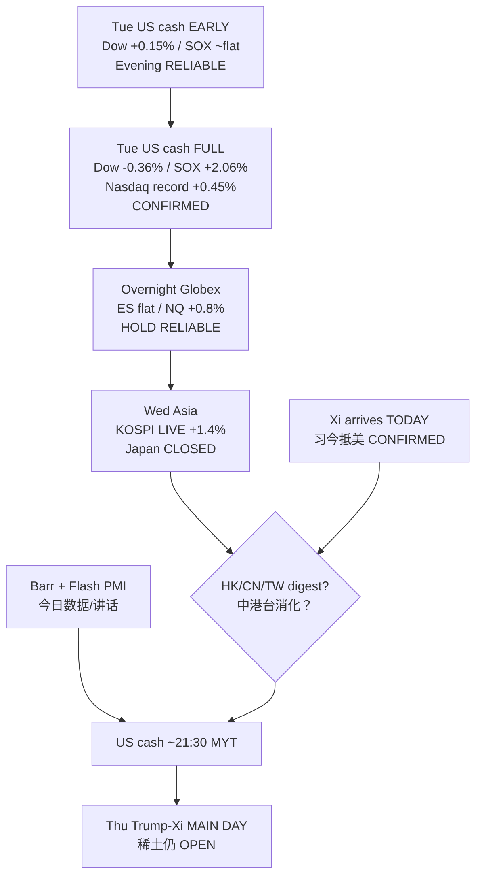

# AI Factory Daily Market Report / AI 工厂每日市场报告

**Session / 时段:** Morning / 早盘  
**Timestamp / 时间戳:** 2026-09-23 ~08:46 MYT (Asia/Kuala_Lumpur)  
**Market mood / 市场情绪:** **Tue US cash FULL = MIXED DIGESTION + SOX CONTINUATION** after Mon record tech bid — Dow **51,863.69 (−0.36%)** faded from evening early green; S&P **7,764.64 (~flat)**; Nasdaq **27,244.28 (+0.45%)** another record close; SOX **12,689.82 (+2.06%)** extended Mon; QQQ **747.46 (+0.81%)**; overnight Globex **ES ~7,831 flat / NQ ~31,038 (+0.8%)**; Wed Asia = **KOSPI LIVE ~7,117 (+1.4%)** + **Japan TSE CLOSED** (Equinox) · **Xi arrives Joint Base Andrews TODAY** ahead of Thu main summit · **周二完整现金=混合消化+半导体重续**；隔夜期货纳指端偏多；韩股实时续涨；日本休市；**习近平原今抵美**

---

## 0. Header notes / 页眉说明

- **Calendar / 假日 (CONFIRMED Master + JPX):** **Japan TSE cash CLOSED** Wed Sep 23 (Autumnal Equinox). Cash equity resumes **Thu Sep 24**. **Korea Chuseok closes Sep 24–25**. **China Mid-Autumn Sep 25**. Korea OPEN today; HK/CN ~09:30 MYT; MY/TW ~09:00 — at this stamp HSI/SSE/TWSE/KLCI still show **Tue closes** (pre-open / not yet Wed session in Yahoo).  
- **PRIMARY upgrade vs Tue Evening EARLY:** Evening (~21:40 MYT) was **~7–10 min after US open**. Full Tue cash now **CONFIRMED** (Yahoo daily + Asia Business Daily wrap): Dow **faded** to red; Nasdaq **held** mild green + **another record close**; **SOX continued +2.06%** (evening early was ~flat −0.02% — material upgrade); VIX **14.21 (−4.44%)**.  
- **Overnight Globex → Wed Asia (PRIMARY tape, Yahoo ~08:46 MYT):** ES **~7,830.75 (−0.04% vs Mon fut bar 7,833.5)** / NQ **~31,038.25 (+0.82% vs 30,784.75)** / YM **~52,270 (−0.39%)** / RTY **~2,912.9 (+0.53%)**. Tech-futures bid **held/extended**; Dow futures soft — rhymes with Tue cash mix.  
- **Asia Wed morning labels:** **KOSPI LIVE ~7,117–7,120 (+~1.4% vs Tue close 7,017.91)**; open print wires **~7,154 (+1.94%)** then mild fade (Seoul Economic Daily / Yahoo). **Nikkei = Fri LOCKED 65,018.95** (holiday). **HSI 25,087.75 / SSE 3,952.13 / CSI 300 4,544.59 / TWSE 47,800.17 / FBM KLCI 1,683.50** = **Tue closes** at stamp. **DAX Tue close 25,578.85** (Yahoo).  
- **Oil / rates / FX overnight:** Continuous Yahoo: CL=F **~90.15** / BZ=F **~99.23** — deeper vs Mon settles (WTI 95.78 / Brent 100.34); residual of **Iran Hormuz conditional 7-day reopen offer** already archived Tue Evening (**do not re-discover**). 10Y **^TNX 4.968%**; DXY **~100.57**; USD/JPY **~157.51**; BTC **~86.4k**.  
- **Watchlist Tue full closes (Yahoo regularMarketPrice stamped ~Tue 16:00 ET / 04:00 MYT Wed):** **MU $1,096.16 (+5.00%)** leader; **ARM $333.20 (+3.19%)** / **QCOM $198.27 (+2.08%)** / **MRVL $262.36 (+1.93%)** / **SPCX $154.72 (+1.89%)** / **INTC $123.86 (+1.71%)** / **CRWV $86.76 (+1.56%)** / **UMC $25.77 (+1.34%)** / **PLTR $184.99 (+1.04%)** / **TSLA $378.90 (+0.96%)** / **NVDA $228.87 (+0.66%)** / **AVGO $364.54 (+0.52%)** / **AAPL $339.75 (+0.23%)**; **LITE $945.67 (−0.92%)** sole core laggard (evening early leader faded).  
- **Catalyst stack LIVE (Master ~08:25 MYT, ALERT=NO):** **Xi arrives Joint Base Andrews Wed Sep 23** (CONFIRMED White House); **Trump–Xi main day Thu Sep 24** (rare earths / Nov 10 truce / AI / Taiwan / Iran **OPEN**); Fed Gov **Barr ~10:05 ET today**; **S&P Global Flash US PMI ~9:45 ET today**; Starship Flight 14 **NET Mon Sep 28**; **MU FY2026 Q4 Wed Sep 30**; BOJ rates effective Thu Sep 24. Hormuz offer = archived continuity, not new alert.  
- **Sources:** Yahoo Finance v8 (~08:43–08:46 MYT), Asia Business Daily Tue US wrap, Seoul Economic Daily KOSPI open, White House / gov.cn / Reuters / ABC summit logistics, Master Event Monitor 2026-09-23, Tue Evening continuity. Unverified = `N/A (unverified)`.  
- **SPCX:** Nasdaq-listed Space Exploration Technologies Corp. (SpaceX｜太空探索技术公司), first trade **2026-06-12** (**CONFIRMED**). **CRWV:** public CoreWeave (CoreWeave｜CoreWeave).

- **假日：** **日本现货秋分休市**；韩国中秋 **9/24–25**；中国中秋 **9/25**。  
- **美股现金：** 周二完整会话相对晚间早盘=道指回吐、纳指守住并再创纪录收盘、**SOX 续涨 +2%**（早盘近乎持平被升级）。  
- **隔夜→周三：** 期货纳指端偏多、道指期货偏软；韩股实时续涨；日经锁定；中港台马约 08:46 仍多为周二收盘/待开。  
- **催化：** **习今抵美**；特习主日 **9/24**（稀土未解）；Barr + Flash PMI 今日；星舰约 **9/28**；美光 **9/30**。

---

## 1. Market snapshot / 市场速览

### Compact tape / 速览表

| Asset / 资产 | Last / 最新 | 1D% / 日涨跌 | Note / 备注 |
|---|---:|---:|---|
| Dow Jones | 51,863.69 | −0.36% | **Tue full close** (faded vs evening early +0.15%) |
| S&P 500 | 7,764.64 | −0.00% | **Tue full** — essentially flat vs Mon 7,764.70 |
| Nasdaq Composite | 27,244.28 | +0.45% | **Tue full — another record close** |
| Nasdaq-100 / QQQ | QQQ 747.46 | +0.81% | **Tue close** |
| Dow futures (YM) | ~52,270 | −0.39% vs Mon fut bar | **Overnight Globex** Yahoo ~08:46 |
| S&P futures (ES) | ~7,830.75 | −0.04% | **Overnight flat HOLD** |
| Nasdaq-100 futures (NQ) | ~31,038 | +0.82% | **Overnight tech bid** |
| Russell 2000 futures (RTY) | ~2,912.9 | +0.53% | Overnight mild bid |
| SOX (PHLX Semi｜费城半导体指数) | 12,689.82 | +2.06% | **Tue full — CONTINUATION** (evening early ~flat) |
| Russell 2000 | 2,889.92 | +0.51% | **Tue close** |
| QQQ | 747.46 | +0.81% | Tue close |
| VIX | 14.21 | −4.44% | Tue close — softer |
| JNK | 94.72 | ~+0.01% vs Mon 94.71 | Tue ~flat (Yahoo) |
| NBI (Biotech｜生物科技指数) | 7,165.11 | +1.67% | Tue close |
| Brent (BZ=F continuous) | ~99.23 | vs Mon bar 100.34 | **Overnight Yahoo** — deeper |
| WTI (CL=F continuous) | ~90.15 | vs Mon bar 95.78 | **Overnight Yahoo** — deeper |
| Brent Nov Mon settle | 100.34 | −3.40% Mon | Named settle (prior) |
| WTI Oct Mon settle | 95.78 | −4.51% Mon | Named settle (prior) |
| US 2Y proxy (^IRX 13W bill) | 4.005% | +0.58% bar | Bill ≠ note — labeled |
| US 5Y yield (^FVX) | 4.842% | +0.17% bar | Tue |
| US 10Y yield (^TNX) | 4.968% | +0.10% bar | Tue ~4.97% |
| US 20Y yield | N/A (unverified) | N/A (unverified) | Not fetched |
| US 30Y yield (^TYX) | 5.303% | +0.13% bar | Tue |
| DXY | ~100.57 | +0.14% vs Mon bar | Overnight Yahoo |
| XAUUSD / Gold | GC=F ~4,396.5 | +0.29% vs Mon bar | Soft-firm |
| XAGUSD / Silver | SI=F ~67.90 | +3.14% vs Mon bar | Firm |
| London Gold | N/A (unverified) | N/A (unverified) | Futures used as proxy |
| SSE Composite | 3,952.13 | +0.06% Tue | **Tue close** — Wed ~09:30 pending |
| CSI 300 | 4,544.59 | +0.11% vs prior bar | **Tue close** |
| FBM KLCI | 1,683.50 | +0.99% Tue | **Tue close** — Wed ~09:00 pending |
| KOSPI | ~7,117 | +~1.4% vs Tue 7,017.91 | **Wed LIVE** (open wires ~7,154 +1.94%) |
| Nikkei 225 | 65,018.95 | +1.38% Fri | **HOLIDAY — Fri LOCKED** |
| Hang Seng | 25,087.75 | +0.18% Tue | **Tue close** — Wed ~09:30 pending |
| TWSE / Taipei | 47,800.17 | +0.17% Tue | **Tue close** — Wed ~09:00 pending |
| DAX | 25,578.85 | +0.01% vs Mon 25,575 | **Tue Europe close** (Yahoo) |
| USD/JPY | ~157.51 | mild JPY soft | Yahoo Wed |
| USD/SGD | ~1.2748 | mild SGD firm | Yahoo |
| USD/TWD | ~31.69 | mild TWD firm | Yahoo |
| USD/MYR | ~4.068 | mild MYR firm | Yahoo |
| USD/KRW | ~1,348.6 | KRW firmer | Yahoo −1.83% bar |
| GBP/USD | ~1.3339 | mild soft | Yahoo |
| EUR/USD | ~1.1452 | mild soft | Yahoo |
| AUD/USD | ~0.7118 | ~flat | Yahoo |
| USD/CNY | ~6.6897 | mild CNY firm | Yahoo |
| MYR/JPY | ~38.72 | N/A (calc) | 157.51/4.068 |
| MYR/KRW | ~331.5 | N/A (calc) | Derived |
| MYR/CNY | ~1.645 | N/A (calc) | Derived |
| MYR/THB | ~8.14 | N/A (calc) | 33.10/4.068 |
| SGD/MYR | ~3.191 | N/A (calc) | 4.068/1.2748 |
| BTC | ~86,447 | mild overnight soft vs Mon spike | Yahoo |
| ETH | ~2,761 | mild soft | Yahoo |

### Tape read / 盘面解读

1. **Tue full cash ≠ evening early (Fact):** Dow early +0.15% → full **−0.36%**; SOX early ~flat → full **+2.06%**; Nasdaq held **+0.45% record**. / **完整会话≠早盘快照——道指回吐、SOX 续涨。**  
2. **Overnight Globex tech HOLD/EXTEND (Fact):** ES flat / NQ **+0.8%** — digestion did **not** become a tech gap-down. / **隔夜科技期货守住并偏强。**  
3. **KOSPI LIVE continuation (Fact):** Open ~**+1.94%** → live ~**+1.4%**; Japan holiday still thins regional beta. / **韩股实时续涨；日本休市稀释贝塔。**  
4. **Oil deeper residual (Fact):** CL ~**90** / BZ ~**99** — Hormuz-offer fade continuity (archived). / **油价更深=已归档缓和的延续。**  
5. **Summit event-vol RISING today (Fact):** Xi arrives Andrews **today**; main day **Thu Sep 24**; rare earths still **OPEN**. / **峰会事件波动今日升温。**

**What this means / 这说明什么:**  
Morning spine = **(1) Tue US cash was mixed digestion with SOX/memory continuation, (2) overnight did not break the tech handoff, (3) Korea carries the bid while Japan is closed, (4) Xi-arrival day + Barr/PMI are today's vetoes before Thu summit substance**. Do **not** treat Dow fade as “tech broken” while SOX +2% and NQ futures +0.8%.  
早盘主线 = **（1）周二现金混合消化但半导体/存储续强，（2）隔夜未打断科技交接，（3）韩股扛住而日本休市，（4）习抵美日+Barr/PMI 为今日否决点，周四看峰会实质**。勿用道指回吐否定 SOX。

---

## 2. Hot topics / 热点

### 2.1 Tue US cash FULL — PRIMARY upgrade / 周二完整现金——主升级
- **What (CONFIRMED Yahoo + Asia Business Daily):** Dow −0.36%, S&P flat, Nasdaq +0.45% **another record**, SOX **+2.06%**, QQQ +0.81%, VIX 14.21. MU **+5.0%** led watchlist; LITE −0.92% faded from evening early leadership.  
- **Why AI-factory:** Evening “digestion” thesis **partially holds** (Dow fade, breadth mix) but **SOX/memory continuation** means hardware sleeve did **not** mean-revert hard — transmission node **Cash Digestion** now **POST-ACTUAL full** with a **semi-positive skew**.  
- **Near vs structural:** Near = Asia digest + summit headline risk; structural = CapEx pacing + WACC (Weighted Average Cost of Capital｜加权平均资本成本).  
- **说明：** 晚间“早盘消化”升级为“完整混合消化+半导体重续”；下一问题换成习抵美日 headline 与亚洲开盘。

### 2.2 Xi arrives TODAY — summit lifecycle ACTIVE / 习今抵美——峰会生命周期活跃
- **What (CONFIRMED White House + gov.cn; RELIABLE ABC/Reuters):** Xi greeted at Joint Base Andrews **Wed Sep 23**; main White House day **Thu Sep 24** (ceremony, bilateral, state dinner); farewell/Archives **Fri Sep 25**. Trump personal airport greeting = unusual protocol optics. Agenda: tariff-truce extension (~Nov 10), **rare earths**, AI, Taiwan, Iran, ag/Boeing. Experts split on deliverables; RE leverage keeps US tone less hostile (Reuters Sep 21).  
- **Why AI-factory:** Tariff / export-control / critical-minerals path hits Asia foundry / memory / optical supply-chain beta — especially into Korea Chuseok thinness.  
- **Near vs structural:** Near = headline veto Wed–Thu; structural = Nov 10 cliff + RE supply assurance.  
- **说明：** 程序/礼仪进展 ≠ 稀土与停火延期闭环；预期差仍开。

### 2.3 Overnight NQ bid vs Dow-fut soft / 隔夜纳指期货偏多 vs 道指期货偏软
- **What (RELIABLE Yahoo ~08:46):** NQ +0.8% / ES flat / YM −0.4% — mirrors Tue cash mix into Wed Asia.  
- **Why:** Falsifies “full-session fade cascade into Globex gap-down” overnight-break risk from Evening list — **so far**.  
- **说明：** 假说未触发 ≠ 永远安全；中港台开盘与美股前仍可回吐。

### 2.4 Oil deeper — archived continuity (no re-alert) / 油价更深——归档延续（不重复警报）
- **What:** CL ~90 / BZ ~99 on residual of Iran Hormuz **conditional** 7-day reopen offer (Tue Reuters → Evening archive). Master **ALERT=NO** — do not re-discover.  
- **Why:** Easier inflation optics at the margin; geopolitics still conditional, not a deal.  
- **说明：** 缓和已定价一段；若提议崩塌才是新警报。

### 2.5 Barr + Flash PMI today; Japan holiday + KR Chuseok ahead / 今日Barr与闪现PMI；日本休市+韩国中秋临近
- **What (CONFIRMED Fed/S&P calendars):** Barr Economic Outlook & Housing ~**10:05 ET**; Flash US PMI ~**9:45 ET**; EZ/UK PMI cluster earlier UTC. JP closed through today; KR closed Sep 24–25; CN Mid-Autumn Sep 25.  
- **Why:** Thin Asia liquidity into summit main day — gap risk rises. Barr/PMI = reaction-function / growth optics until surprise.  
- **说明：** 假日周是风险放大器；数据日是噪声过滤器。

---

## 3. Sector Pulse / 板块脉搏

AI factory flow: **Power → Compute → Memory & Storage → Optical → Cloud Data → Agents → Applications → Physical AI**.

| Sleeve / 袖套 | Breadth / 广度 | Leaders / 领涨 | Laggards / 落后 | 1D read (Tue full) |
|---|---|---|---|---|
| 1. Accelerators / GPUs / CPUs | Firm selective | NVDA +0.66%; ARM +3.19%; QCOM +2.08% | — | Compute held after Mon spike |
| 2. Memory DRAM/HBM/NAND | **Very strong** | **MU +5.00%** | — | Pre-earnings bid accelerated |
| 3. CPO/MPO/Photonics | Soft | — | **LITE −0.92%** | Evening early leader faded |
| 4. Networking | Firm | MRVL +1.93%; AVGO +0.52% | — | Custom/network follow |
| 5. Semi Equipment / Foundry | Firm | INTC +1.71%; UMC +1.34% | — | Post-spike digest green |
| 6. Data Center Power | N/A sleeve prints | N/A (unverified) | — | Oil softer = opex optics ease |
| 7. MAG7 + SPCX + Frontier | Mixed-firm | SPCX +1.89%; TSLA +0.96%; AAPL +0.23% | — | Space **caught up** vs Mon lag |
| 8. China’s A-share leaders | Tue soft green locked | SSE +0.06% Tue | — | Wed open pending |
| 9. ASEAN / Taiwan | Tue soft green locked | TWSE +0.17%; KLCI +0.99% Tue | — | Wed open pending |

**What this means / 这说明什么:** Transmission skew = **Memory + SOX continuation**, not optical (LITE fade) and not Dow industrials. SPCX **participated** Tue after Mon lag.  
传导偏斜=**存储+SOX 续涨**；光通信回吐；SPCX 周二补涨。

---

## 4. Watchlist TA / 观察名单技术面

### Glossary box / 术语盒（本报告一次）
- **MA (Moving Average｜移动平均线):** average price over N sessions — trend compass, not a crystal ball.  
- **RSI14 (Relative Strength Index｜相对强弱指标):** 0–100 momentum; >70 often “stretched,” <30 “washed out” — context matters.  
- **MACD (Moving Average Convergence Divergence｜异同移动平均线):** trend/momentum crossover tool — lagging confirmation, not oracle.

| Ticker | Last (Tue) | Volume | 1D% | MA5 | MA10 | MA20 | MA60 | RSI14 | MACD | Catalysts | Risks | Rewards |
|---|---:|---:|---:|---:|---:|---:|---:|---:|---|---|---|---|
| NVDA | 228.87 | N/A Tue bar lag | +0.66% | 222.35 | 219.52 | 220.53 | 212.61 | 61.4 | +2.02 / sig +1.60 | AI CapEx continuum | Multiple if hawkish Barr | Hardware leadership |
| AAPL | 339.75 | N/A | +0.23% | 336.85 | 332.29 | 325.59 | 318.55 | 65.9 | +6.25 / +4.70 | Device/edge AI | Mag7 lag vs semis | Cash-flow compounder |
| MU | 1,096.16 | N/A | **+5.00%** | 1,012 | 989 | 973 | 945 | **70.1** | +24.8 / +14.6 | **Q4 Sep 30** | Guide miss / stretch RSI | Memory bottleneck |
| SPCX | 154.72 | N/A | +1.89% | 152.99 | 150.36 | 147.06 | 138.38 | 61.9 | +4.22 / +3.88 | Starship NET ~Sep 28 | Launch slip | Orbital adjacency |
| TSLA | 378.90 | N/A | +0.96% | 368.55 | 365.51 | 361.72 | 359.02 | 61.6 | +5.57 / +4.19 | Physical AI / energy | Macro beta | Robotaxi narrative |
| ARM | 333.20 | N/A | +3.19% | 288.12 | 270.46 | 257.97 | 271.85 | **78.9** | +9.40 / −0.36 | CPU/IP AI architecture | **Mean-reversion** | Architecture tax |
| QCOM | 198.27 | N/A | +2.08% | 188.75 | 184.70 | 175.93 | 171.62 | **74.0** | +6.50 / +4.14 | Edge AI SoC | Handset cycle | Edge attach |
| CRWV | 86.76 | N/A | +1.56% | 83.36 | 85.37 | 86.11 | 85.63 | 54.8 | −1.24 / −0.92 | GPU cloud demand | Dilution / convert | Infra scarcity |
| MRVL | 262.36 | N/A | +1.93% | 246.89 | 237.31 | 230.15 | 222.75 | **73.5** | +7.46 / +3.70 | Custom silicon / optical adj. | Customer concentration | DC networking |
| INTC | 123.86 | N/A | +1.71% | 112.82 | 106.79 | 99.28 | 101.24 | **79.7** | +4.98 / +1.90 | Foundry / CPU | **Fade after Mon +12%** | Foundry re-rating |
| UMC | 25.77 | N/A | +1.34% | 24.56 | 23.38 | 21.70 | 21.27 | **77.3** | +1.34 / +0.84 | Mature/specialty foundry | Geo / utilization | Specialty mix |
| LITE | 945.67 | N/A | **−0.92%** | 928.82 | 916.98 | 910.35 | 835.85 | 57.7 | +18.9 / +17.9 | Optical / CPO adjacency | CapEx pacing / fade | Photonics bottleneck |
| PLTR | 184.99 | N/A | +1.04% | 179.26 | 174.48 | 176.51 | 154.94 | 54.2 | +4.32 / +4.40 | Enterprise AI platforms | Valuation air | Agent/data attach |
| AVGO | 364.54 | N/A | +0.52% | 354.32 | 354.28 | 359.32 | 378.82 | 46.8 | −6.94 / −8.56 | ASICs / networking | Custom cycle | AI silicon breadth |

*MA/RSI/MACD computed from Yahoo daily series + Tue regularMarketPrice appended where daily bar lagged (labeled). Volumes for Tue full session = N/A (unverified) until Yahoo writes Sep 22 bars. 1D% = vs Mon close Fact.*

**Evening early → Full evolution (teaching):** LITE early **+1.25% → full −0.92%**; SPCX early **−0.81% → full +1.89%**; ARM/INTC early ~flat → full **+3.2% / +1.7%**; MU not highlighted early → full **+5.0% leader**.

**What this means / 这说明什么:** Stretched RSI cluster (ARM/INTC/MU/QCOM/MRVL/UMC >70) = **positioning risk** even when narrative intact — separate Fact (price) from Hypothesis (hold into summit).  
RSI 拥挤区意味着**拥挤风险**；价格事实≠能否守住的假说。

---

## 5. Supply Chain / 供应链

Only movers with clear links:

1. **SOX +2.06% + MU +5% → Memory bottleneck bid** into Sep 30 print — mid-chain scarcity optics, not only GPU. / 存储瓶颈抢跑美光财报。  
2. **ARM/QCOM/INTC still green post-Mon spike → CPU/edge/foundry sleeve digesting higher** — not a cascade washout overnight. / 算力架构袖套高位消化而非崩塌。  
3. **LITE −0.92% → Optical sleeve took profit** after evening early leadership — downstream bandwidth narrative paused 1D. / 光通信一日获利回吐。  
4. **SPCX +1.89% → Space sleeve caught Mon AI soft lag** — Starship NET ~Sep 28 still separate catalyst. / 航天袖套补涨；星舰催化仍独立。

Quiet forced chains: skip.

---

## 6. Risks & Outlook / 风险与展望

**What can invalidate before Afternoon run (~17:30 MYT) / US cash (~21:30 MYT):**

| # | Risk / 风险 | Why it matters | Watch / 观察 |
|---|---|---|---|
| 1 | Soft HSI/SSE/TW opens after KOSPI gap | Breaks Korea-led handoff | ~09:00–09:30 MYT opens |
| 2 | Toxic Xi-arrival / rare-earths hard-negative wire | Summit lifecycle primary veto | Wed–Thu wires |
| 3 | Hawkish Barr or hot/soft PMI surprise | Reaction-function / growth optics | ~9:45 / 10:05 ET |
| 4 | Oil re-spike (Hormuz offer collapse) | Re-tightens inflation optics | CL/BZ continuous |
| 5 | ARM/INTC/MU RSI washout into US cash | Mean-reversion of stretched names | Premarket / US open |
| 6 | Japan holiday + KR Chuseok liquidity thin | Amplifies gaps into Thu summit | Calendar CONFIRMED |

**PRIMARY next veto:** **Xi-arrival / summit wires today + Barr/PMI (~21:45–22:05 MYT)** then **US cash open ~21:30 MYT**; structural next = **Thu Sep 24 Trump–Xi main day**.

**Outlook (research framing, not advice):** Base = Korea/SOX continuation digests into thin holiday Asia with summit event-vol rising; next hard nodes = **Thu summit substance** and **MU Sep 30**. Bear = toxic RE wire + oil spike + RSI cascade. Bull = constructive arrival optics + orderly Asia hold into Thu.  
展望（研究框架，非建议）：基准=韩股/SOX 续涨在假日薄流动性中消化、峰会波动升温；下一硬节点=周四峰会实质与美光。

---

## 7. Classification buckets / 分类桶

### Section A — Categories
1. Structural compounders  
2. Re-rating candidates  
3. Bottleneck growth  
4. Physical infrastructure  
5. High optionality  
6. Agent / data beneficiaries  

### Section B — Names
| Category | Tickers |
|---|---|
| 1 Structural compounders | NVDA, AAPL, AVGO |
| 2 Re-rating candidates | INTC, ARM, QCOM |
| 3 Bottleneck growth | MU, LITE, MRVL |
| 4 Physical infrastructure | CRWV, UMC, SPCX |
| 5 High optionality | TSLA, SPCX |
| 6 Agent / data beneficiaries | PLTR |

### Section C — Core thesis (short)
- **NVDA/AVGO:** accelerator/custom silicon scarcity.  
- **MU:** HBM/DRAM bottleneck into Sep 30 print — Tue bid accelerated.  
- **LITE/MRVL:** optical/networking attach; LITE took 1D profit.  
- **INTC/ARM/QCOM:** architecture/foundry/edge re-rating digesting Mon extremes.  
- **CRWV:** GPU cloud scarcity.  
- **PLTR:** enterprise agent/data platforms.  
- **TSLA:** Physical AI beta.  
- **SPCX:** orbital launch/adjacency — Tue catch-up vs Mon lag.  

### Section D — Primary risk / outlook
- **MU/ARM/INTC:** RSI stretch + event/fade risk.  
- **LITE:** momentum pause after fade.  
- **SPCX:** launch timing NET Sep 28.  
- **All:** WACC + Trump–Xi headline veto Wed–Thu.

---

## 8. AI Factory full-chain analysis / AI 工厂全产业链

### Demand & supply environment / 需求与供给
- **Demand:** Tue tape showed **memory/SOX continuation** after Mon application-spark day — Fact. Digestion was **index-mix**, not hardware washout.  
- **Supply:** HBM/foundry/packaging still binding physical bottlenecks (Hypothesis consistent with prior OS; no new capacity print overnight).  

### Rate / rate-cut logic / 利率逻辑
- 10Y **~4.97%** (+0.1% bar vs Mon 4.963%) with oil deeper — inflation optics easier, but Barr speech today keeps **reaction-function** live. WACC still binds long-duration AI multiples (Inference). Green SOX ≠ path absolution.

### Valuation layers (sleeve leaders — schematic) / 估值三层（示意）
| Name | Fundamental | Market | Probability sketch |
|---|---|---|---|
| NVDA | Rev/margin leadership in accelerators | Premium multiple on growth | Bull 30% / Base 45% / Bear 25% |
| MU | HBM mix + DRAM cycle | Event premium into Sep 30; RSI>70 | Bull 25% / Base 40% / Bear 35% — print risk up |
| INTC | Foundry optionality + CPU | Post-spike digest green | Bull 25% / Base 40% / Bear 35% — fade risk |
| ARM | IP royalty on AI CPU | Extreme stretch RSI~79 | Bull 20% / Base 40% / Bear 40% — mean-reversion |
| LITE | Optical/CPO attach | 1D fade after leadership | Bull 25% / Base 45% / Bear 30% |
| SPCX | Launch cadence / Starlink adjacency | Tue catch-up | Bull 30% / Base 45% / Bear 25% — NET Sep 28 |

*Probabilities = research Hypothesis sketches, not forecasts or advice.*

### Company strategic map / 公司战略地图
| Ticker | Positioning | Benefit | Main bottleneck |
|---|---|---|---|
| NVDA | Accelerators | Scarcity rent | Customer CapEx pacing |
| MU | Memory | HBM attach | Bit supply / Sep 30 guide |
| LITE | Photonics | Bandwidth wall | CapEx timing |
| INTC | Foundry/CPU | Re-rating option | Execution / credibility |
| ARM | IP | Architecture tax | Customer concentration |
| CRWV | GPU cloud | Infra scarcity | Funding / dilution |
| SPCX | Orbital | Physical AI adjacency | Launch schedule |
| PLTR | Software/data | Agent attach | Valuation air |

### Investment decision checklist / 投资决策清单（教育用）
1. Did Tue full cash confirm evening digestion? → **PARTIAL YES** — Dow fade yes; SOX continuation = skew (Fact).  
2. Did overnight break tech handoff? → **NO so far** (Fact).  
3. Is summit substance closed? → **NO — Xi arrives today** (Fact).  
4. Is MU print known? → **NO until Sep 30** (Fact).  
5. Are ARM/INTC/MU RSI moves durable? → **OPEN** (Hypothesis).  

### Key conclusions / 关键结论
**EN:** Tue US cash full session was **mixed digestion with SOX/memory continuation** (not a broad melt-up, not a tech break); overnight Globex held with NQ bid; Wed Asia opens with KOSPI continuation and Japan closed; **Xi arrives today** — next falsifiers = Asia ex-Japan opens, arrival/summit wires, Barr/PMI, oil, and stretched-name behavior into US cash.  
**ZH:** 周二美股现金完整会话是**混合消化+半导体/存储续涨**（非全面熔涨，亦非科技破裂）；隔夜期货纳指端守住；周三亚洲韩股续涨、日本休市；**习近平原今抵美**——下一证伪点=中港台开盘、抵美/峰会 headline、Barr/PMI、油价与拥挤个股在美股开盘前的表现。

---

### Thinking Tutorial / 思维教程 — Early print → Full cash → Overnight → Summit day

1. **Observe:** Early digestion ≠ full digestion skew — SOX flipped from flat to +2%.  
2. **Why:** AI-factory chain needs **session-label discipline** before chaining conclusions.  
3. **Falsifier:** Soft Asia opens + toxic RE wire + RSI cascade + oil spike.  
4. **Practice:** Upgrade claim class only when the **next session** prints (today = Asia opens + US cash).

**What this means / 这说明什么:** Teach the habit — **evening early is a trailer, full cash is the feature, overnight is the handoff, summit day is the veto**.  
养成习惯：**早盘是预告、完整现金是正片、隔夜是交接、峰会日是否决**。

---

## 9. Disclaimer / 免责声明

This report is for **research and education only**. It is **not** investment advice, a solicitation, or a recommendation to buy/sell any security. Data may lag or differ across vendors (especially futures continuous vs named contract settles; stock Tue volumes pending Yahoo bar write). Always verify primary sources and do your own research.  
本报告仅供**研究与教育**，**不构成**投资建议或买卖邀约。数据可能滞后或因供应商/合约月份而异。请自行核实原始来源并独立研究。

**As-of:** 2026-09-23 ~08:46 MYT · Sources listed in §0 · SPCX = Nasdaq-listed SpaceX · No invented prices · Master ALERT=NO.
