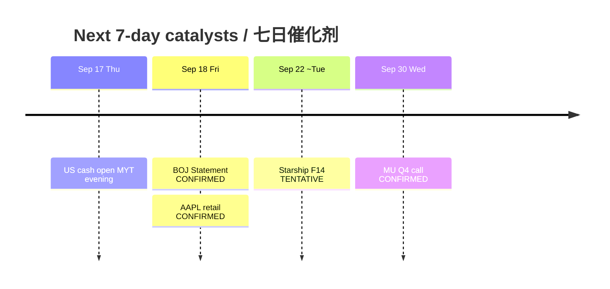

# Catalyst Timeline — Next 7 Days / 催化剂时间线（未来七日）

**As-of:** 2026-09-17 ~17:45 MYT  
**Claim class:** CONFIRMED / TENTATIVE / RUMOR labeled per row  
**Session:** Afternoon / 午后

| Date (local) | Event | Status | Why it matters for AI factory |
|---|---|---|---|
| Thu Sep 17 ~21:30 MYT | US cash open | CONFIRMED schedule | Tests futures repair vs Wed Fed fade |
| Fri Sep 18 | **BOJ Statement** (MPM ends) | **CONFIRMED** calendar; clock undecided | JPY/carry/Asia liquidity weekend veto |
| Fri Sep 18 | AAPL iPhone 18 Pro/Pro Max **retail** | **CONFIRMED** Apple Newsroom | Edge-demand optics (secondary vs BOJ) |
| Fri Sep 18 | BOJ hike to ~1.25% chatter | **RUMOR / market pricing** | Not a BOJ fact — do not treat as decided |
| ~Tue Sep 22 | SpaceX **Starship Flight 14** window | **TENTATIVE** (FAA/wires; weather) | SPCX event beta; scrub risk |
| Wed Sep 30 2:30pm Mountain | **MU FY2026 Q4** call | **CONFIRMED** IR | HBM/memory hard print |
| Ongoing | TSLA NHTSA **AQ26002** Cybercab | **CONFIRMED** | Regulatory overhang on Physical AI |
| Residual | FOMC Sep path digestion | CONFIRMED decision done | 4.1/4.1 SEP still binds multiples |

### Thinking caption / 思维说明
- **Observe:** Two CONFIRMED near events Fri (BOJ + AAPL retail); Starship is TENTATIVE; MU is the next hard fundamental.  
- **Why:** Avoid stacking unverified “hike decided” language on BOJ.  
- **Falsifier:** BOJ time/content surprise; Starship scrub; MU guide break.

**What this means / 这说明什么:** Sequence risk = **cash tonight → BOJ Fri → Starship window → MU Sep 30**.
