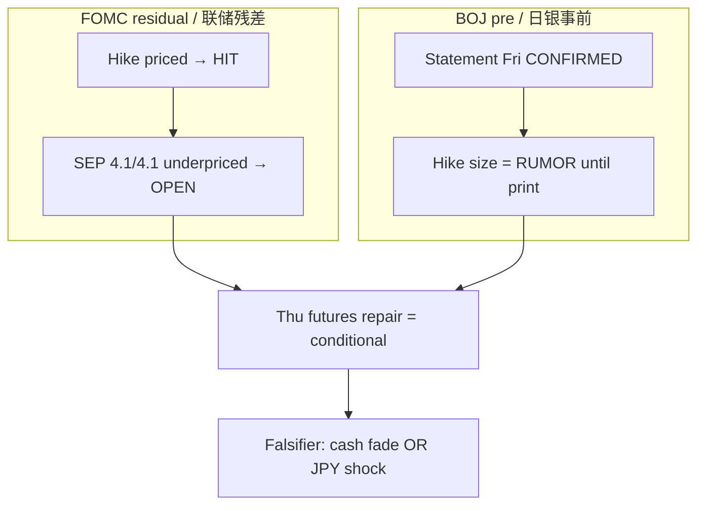

# Expectation Gap — BOJ Pre-Event + Residual FOMC / 预期差

**As-of:** 2026-09-17 ~17:45 MYT  
**Lifecycle:** FOMC Sep 2026 = **post-mortem complete**; BOJ Sep 18 = **pre-event active**  
**Claim class:** CONFIRMED (calendars/decision) / INFERENCE (gaps) / RUMOR (BOJ hike chatter)

## A. Residual FOMC gap / 美联储残差

| Item | Pre-event expectation | Actual | Gap |
|---|---|---|---|
| Binary hike +25bp | ~92–94% priced | +25bp 12–0 | **Narrow** — HIT |
| Path / SEP | Soft-ish / cuts into 2027 narrative | FF **4.1%/4.1%**; 16/18 ≥ another hike | **Wide hawkish** — main gap |
| Press tone | Balanced | Warsh inflation “too high too long” | Hawkish vs dovish hope |
| Market reaction | Two-phase called partially | Bid then fade; Dow −1.21%, NQ flat, SOX +0.63% | **PARTIAL** vs our forecast |

**Still open:** Whether Thu–Fri cash **re-absorbs** 4.1/4.1 without another leg lower.

## B. BOJ pre-event gap / 日银事前预期差

| Item | Market chatter | Official | Gap status |
|---|---|---|---|
| Meeting dates | Sep 17–18 | **CONFIRMED** BOJ schedule | None |
| Statement Friday | Expected | **CONFIRMED** after MPM | None on timing calendar |
| +25bp to ~1.25% | Widely discussed in wires | **Not published** (no Sep 18 statement yet) | Treat as **RUMOR/pricing** — wide if hold, narrow if hike |
| USD/JPY | ~155.7 | Live Yahoo | Carry sensitive into announcement |

### Thinking caption / 思维说明
1. **Observe:** FOMC binary gap closed; **path gap open**. BOJ calendar gap closed; **decision gap open**.  
2. **Why:** Afternoon green futures can be wrong if either open gap prints hawkish.  
3. **Falsifier:** Soft BOJ + cash hold = gap narrows; hawkish BOJ or cash fail = gap re-widens risk-off.

**What this means / 这说明什么:** This pack keeps expectation-gap **active** for BOJ pre-event and FOMC path residue — not a skip.
