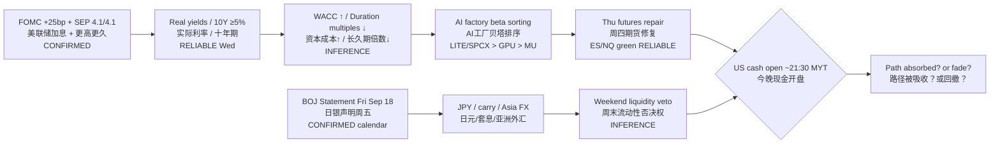

# Transmission Chain — Afternoon 2026-09-17 / 传导链 — 午后

**As-of:** 2026-09-17 ~17:45 MYT  
**Claim class:** ILLUSTRATIVE structure; node facts CONFIRMED/RELIABLE as labeled  
**Source:** FOMC post-mortem + Yahoo Globex/Asia closes + BOJ calendar

### Thinking caption / 思维说明
1. **Observe / 观察:** Dual chain — Fed path still binds WACC; BOJ is the next FX branch. Futures green is a **middle node**, not the end.  
2. **Why it matters / 为何重要:** AI-factory names (NVDA/ARM/LITE/CRWV) trade duration; Asia tech also trades carry into Fri.  
3. **Falsifier / 证伪:** Cash opens through Wed lows **or** BOJ delivers a disorderly JPY move — then “repair” node breaks.

**What this means / 这说明什么:** Do not read NQ +1% as SEP absolution. Read it as **conditional repair** pending cash + BOJ.
