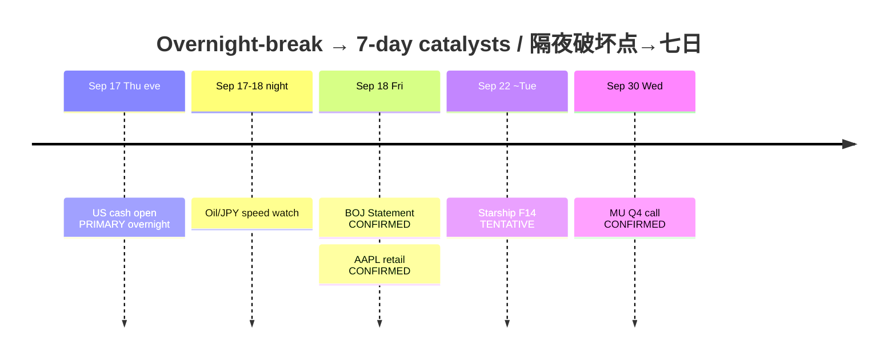

# Catalyst Timeline — Next 7 Days / 催化剂时间线（未来七日）— Evening

**As-of:** 2026-09-17 ~21:20 MYT  
**Claim class:** CONFIRMED / TENTATIVE / RUMOR labeled per row  
**Session:** Evening / 晚间 — **overnight-break risks emphasized**

| Date (local) | Event | Status | Why it matters / overnight-break? |
|---|---|---|---|
| Thu Sep 17 ~21:30 MYT → ~04:00 MYT Fri | **US cash open + full Thu session** | **CONFIRMED** schedule | **PRIMARY overnight break** — tests extended Globex repair |
| Overnight Thu→Fri | Oil / Mid-East / USD/JPY speed | Ongoing | Can invalidate relief tape before Morning |
| Fri Sep 18 | **BOJ Statement** (MPM ends) | **CONFIRMED** calendar; clock **undecided** | **PRIMARY Asia/FX veto** — may land late morning MYT Fri |
| Fri Sep 18 | BOJ hike to ~1.25% chatter | **RUMOR / market pricing** | Not a BOJ fact |
| Fri Sep 18 | AAPL iPhone 18 Pro/Pro Max **retail** | **CONFIRMED** Apple Newsroom | Edge-demand optics (secondary vs BOJ) |
| ~Tue Sep 22 | SpaceX **Starship Flight 14** window | **TENTATIVE** (FAA/wires; weather) | SPCX event beta; scrub risk |
| Wed Sep 30 2:30pm Mountain | **MU FY2026 Q4** call | **CONFIRMED** IR | HBM/memory hard print |
| Ongoing | TSLA NHTSA **AQ26002** Cybercab | **CONFIRMED** | Regulatory overhang on Physical AI |
| Residual | FOMC Sep path digestion | CONFIRMED decision done | 4.1/4.1 SEP still binds multiples |

### Thinking caption / 思维说明
- **Observe:** Overnight stack = **Thu cash first**, then JPY speed, then **BOJ Fri**; AAPL retail secondary; Starship TENTATIVE; MU next hard fundamental.  
- **Why:** Avoid treating BOJ hike as decided; avoid treating Starship window as launch.  
- **Falsifier:** Cash fail vs Globex; BOJ content/JPY shock; Starship scrub; MU guide break.

**What this means / 这说明什么:** Sequence risk = **Thu cash overnight → BOJ Fri → Starship window → MU Sep 30**.
