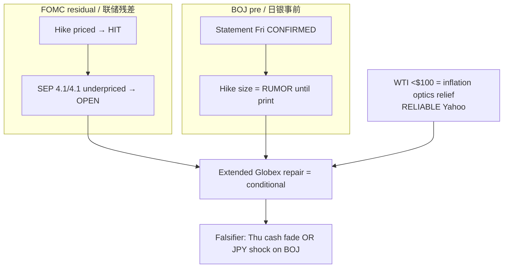

# Expectation Gap — BOJ Pre-Event + Residual FOMC / 预期差（晚间更新）

**As-of:** 2026-09-17 ~21:20 MYT  
**Lifecycle:** FOMC Sep 2026 = **post-mortem complete**; BOJ Sep 18 = **pre-event active** (PRIMARY overnight/Asia veto)  
**Claim class:** CONFIRMED (calendars/decision) / INFERENCE (gaps) / RUMOR (BOJ hike chatter)

## A. Residual FOMC gap / 美联储残差

| Item | Pre-event expectation | Actual | Gap |
|---|---|---|---|
| Binary hike +25bp | ~92–94% priced | +25bp 12–0 | **Narrow** — HIT |
| Path / SEP | Soft-ish / cuts into 2027 | FF **4.1%/4.1%**; 16/18 ≥ another hike | **Wide hawkish** — main gap still OPEN |
| Press tone | Balanced hope | Warsh inflation “too high too long” | Hawkish vs dovish hope |
| Market reaction | Two-phase | Wed bid→fade; Thu Globex **extended repair** | Reaction still **PARTIAL** until cash confirms |

**Still open overnight:** Whether **Thu cash** re-absorbs 4.1/4.1 without another leg lower.

## B. BOJ pre-event gap / 日银事前预期差

| Item | Market chatter | Official | Gap status |
|---|---|---|---|
| Meeting dates | Sep 17–18 | **CONFIRMED** BOJ schedule | None |
| Statement Friday | Expected | **CONFIRMED**; time **undecided** on BOJ site | Calendar closed; clock open |
| +25bp to ~1.25% | Widely discussed (Newsquawk etc.) | **Not published** | **RUMOR/pricing** — wide if hold, narrow if hike |
| USD/JPY | ~155.7 | Live Yahoo | Carry / **speed** sensitive into announcement |

### Thinking caption / 思维说明
1. **Observe:** FOMC binary gap closed; **path gap open**. BOJ calendar gap closed; **decision gap open**. Oil cooler narrows one inflation scare, not the path gap.  
2. **Why:** Evening green futures can still be wrong if either open gap prints hawkish overnight/Fri.  
3. **Falsifier:** Soft BOJ + cash hold = gaps narrow; hawkish BOJ or cash fail = risk-off re-widens.

**What this means / 这说明什么:** Expectation-gap pack stays **active** for BOJ pre-event and FOMC path residue into Morning.
