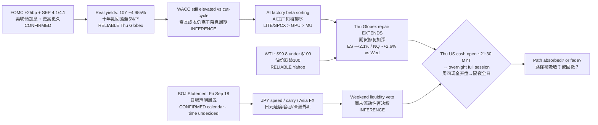

# Transmission Chain — Evening 2026-09-17 / 传导链 — 晚间

**As-of:** 2026-09-17 ~21:20 MYT  
**Claim class:** ILLUSTRATIVE structure; node facts CONFIRMED/RELIABLE as labeled  
**Source:** FOMC post-mortem + Yahoo Globex/Asia + BOJ calendar (statement time undecided)  
**Dominant theme:** Post-FOMC path still binds WACC; **overnight Thu cash** + **BOJ Fri JPY/carry** are the active veto branches

### Thinking caption / 思维说明
1. **Observe / 观察:** Dual active branches — Fed path still binds; BOJ is the next FX gate. Extended green futures + WTI <$100 are **middle nodes**, not the end.  
2. **Why it matters / 为何重要:** Overnight MYT prints Thu cash; Fri BOJ can reprice Asia tech via **JPY speed**.  
3. **Falsifier / 证伪:** Cash opens through Wed lows **or** disorderly JPY on BOJ — then “extended repair” breaks.

**What this means / 这说明什么:** Do not read NQ ~+2.6% vs Wed as SEP absolution. Read it as **conditional deeper repair** pending cash + BOJ.
