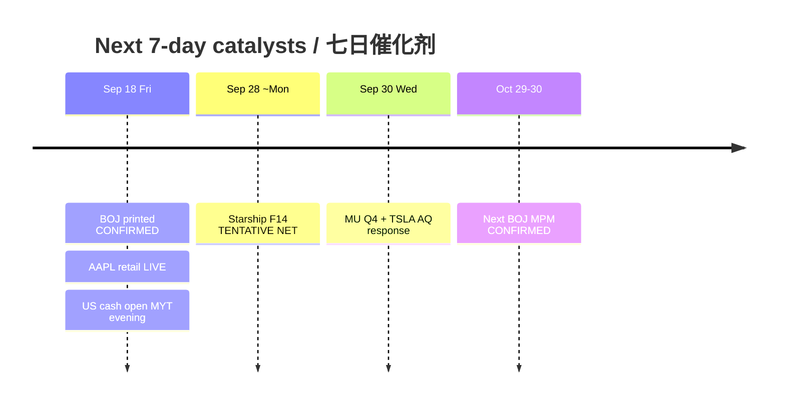

# Catalyst Timeline — Next 7 Days / 催化剂时间线（未来七日）

**As-of:** 2026-09-18 ~17:45 MYT  
**Claim class:** CONFIRMED / TENTATIVE / RUMOR labeled per row  
**Session:** Afternoon / 午后

| Date (local) | Event | Status | Why it matters for AI factory |
|---|---|---|---|
| Fri Sep 18 (done) | **BOJ Statement + hike to ~1.25%** | **CONFIRMED** printed | JPY reaction = weaker; Asia tech bid |
| Fri Sep 18 (done / live) | AAPL iPhone 18 Pro/Pro Max **retail** | **CONFIRMED** Apple Newsroom | Edge-demand optics |
| Fri Sep 18 ~21:30 MYT | **US cash open** | **CONFIRMED** schedule | Tests post-BOJ futures extension |
| ~Mon Sep 28 | SpaceX **Starship Flight 14** | **TENTATIVE** NET (regulatory) | SPCX event beta; was ~Sep 22 |
| Wed Sep 30 ~Sep 30 | TSLA NHTSA AQ26002 **response due** | **CONFIRMED** Special Order | Physical AI regulatory |
| Wed Sep 30 2:30pm Mountain | **MU FY2026 Q4** call | **CONFIRMED** IR | HBM/memory hard print |
| Oct 29–30 | Next **BOJ MPM** | **CONFIRMED** boj.or.jp | Pace of further hikes |
| Residual | FOMC Sep path digestion | CONFIRMED decision done | 4.1/4.1 SEP still binds multiples |

### Thinking caption / 思维说明
- **Observe:** BOJ decision gap **closed**; next hard fundamentals = MU Sep 30; next FX calendar = Oct BOJ.  
- **Why:** Shift veto from “will they hike?” to “cash confirm + JPY orderly + MU print.”  
- **Falsifier:** Cash fade; JPY→160 scare; Starship scrub; MU guide break.

**What this means / 这说明什么:** Sequence risk = **cash tonight → weekend FX → Starship NET Sep 28 → MU/TSLA Sep 30**.
