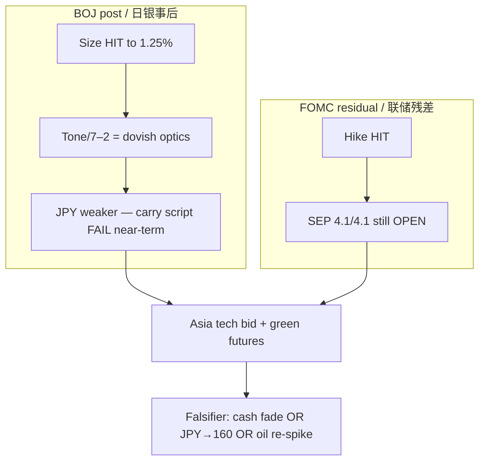

# Expectation Gap — BOJ Post-Print + Residual FOMC / 预期差

**As-of:** 2026-09-18 ~17:45 MYT  
**Lifecycle:** BOJ Sep 18 = **POST-ACTUAL** (printed); FOMC Sep 2026 = post-mortem complete with **path gap still OPEN**  
**Claim class:** CONFIRMED (decision/PDF) / RELIABLE (wire reaction) / INFERENCE (gaps)

## A. BOJ decision gap — CLOSED on size / 日银决策差——幅度已关闭

| Item | Pre-event expectation | Actual | Gap |
|---|---|---|---|
| +25 bp to ~1.25% | Widely priced (was RUMOR/pricing) | **+25 bp to around 1.25%**, 7–2 | **Narrow / HIT** on size |
| Vote unity | Often assumed solid majority | **7–2** (Asada, Sato dissent) | **Wider dovish** optics than unanimous |
| Guidance urgency | Some priced “keep hiking soon” | Continue to raise / data-dependent; no set pace (Ueda) | **Not hawkish surprise** |
| JPY reaction | Many expected JPY stronger / carry stress | USD/JPY **~157.97** — **JPY weaker** | **Opposite** near-term vs carry-unwind script |
| Effective date | — | Sep **24**, 2026 | CONFIRMED |

**Still open:** Pace into **Oct 29–30 MPM**; whether USD/JPY approaches intervention chatter (~160).

## B. Residual FOMC gap / 美联储残差

| Item | Pre-event expectation | Actual | Gap |
|---|---|---|---|
| Binary hike +25bp | Highly priced | +25bp 12–0 | **HIT** |
| Path / SEP | Soft-ish / cuts narrative | FF **4.1%/4.1%** | **Wide hawkish — still OPEN** |
| Thu–Fri absorption | Repair hoped | Thu repair + Fri futures green | **PARTIAL** — cash Fri still pending |

### Thinking caption / 思维说明
1. **Observe:** BOJ **size gap closed HIT**; **delivery/JPY gap surprised** (weaker yen). FOMC **path gap still open**.  
2. **Why:** Afternoon green Asia/futures can still fail if cash doesn’t confirm or FX disorder returns via 160 scare.  
3. **Falsifier:** Soft cash + intervention headlines = risk-off; orderly cash + contained JPY = gap narrows into weekend.

**What this means / 这说明什么:** Expectation-gap pack stays **active** — BOJ post-print reaction gap + FOMC path residue. Not a skip.
