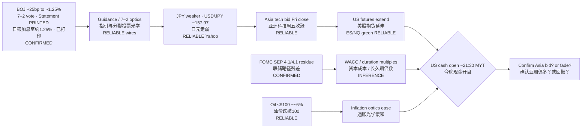

# Transmission Chain — Afternoon 2026-09-18 / 传导链 — 午后

**As-of:** 2026-09-18 ~17:45 MYT  
**Claim class:** ILLUSTRATIVE structure; node facts CONFIRMED/RELIABLE as labeled  
**Source:** boj.or.jp Statement PDF k260918a + Yahoo Globex/Asia closes + Reuters Ueda/FX color

### Thinking caption / 思维说明
1. **Observe / 观察:** Expected “hike → JPY spike → carry unwind” **did not** print first. Actual: hike HIT + JPY soft + Asia bid.  
2. **Why it matters / 为何重要:** AI-factory Asia sleeve got a **conditional green light**; US duration names still need cash + still face Fed path.  
3. **Falsifier / 证伪:** Cash fades Thu support **or** USD/JPY → 160 intervention scare **or** oil re-spikes — then “post-BOJ bid” node breaks.

**What this means / 这说明什么:** Do not read Nikkei/KOSPI green as Fed-path absolution. Read it as **BOJ-delivery optics + oil relief**, pending US cash.
