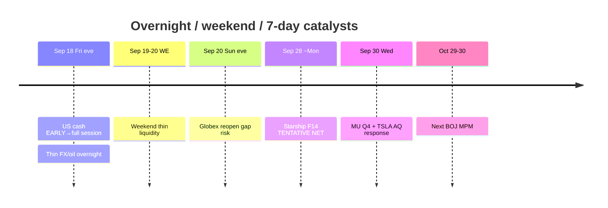

# Catalyst Timeline — Next 7 Days + Overnight/Weekend / 催化剂时间线

**As-of:** 2026-09-18 ~21:40 MYT  
**Session:** Evening / 晚间 — **weekend ahead** before Mon Morning ~08:30 MYT  
**Claim class:** CONFIRMED / TENTATIVE / RUMOR labeled per row

| When | Event | Status | Why it matters / break risk |
|---|---|---|---|
| Fri Sep 18 (done) | BOJ Statement + hike ~1.25% | **CONFIRMED** | JPY weak; Asia tech bid locked |
| Fri Sep 18 (done / live) | AAPL iPhone 18 Pro/Pro Max retail | **CONFIRMED** | Edge-demand optics |
| Fri Sep 18 ~21:30 MYT → late US | **US cash full session** | **CONFIRMED** schedule — **EARLY now** | Can **break** Afternoon Globex thesis if late fade |
| Fri night → Sat MYT | Thin FX / oil wires | Ongoing | **Overnight break:** USD/JPY→160 chatter; oil geopolitics |
| Sat–Sun | Weekend thin liquidity | Structural | Gaps, rumor sensitivity; no deep cash |
| **Sun evening MYT** | **US futures reopen** (typical Globex Sunday) | **CONFIRMED** schedule pattern | **Primary weekend→Mon veto** — gap risk into Mon Asia |
| ~Mon Sep 28 | SpaceX **Starship Flight 14** | **TENTATIVE** NET (regulatory) | SPCX event beta; scrub/delay chatter over weekend |
| Wed Sep 30 | TSLA NHTSA AQ26002 **response due** | **CONFIRMED** | Physical AI regulatory |
| Wed Sep 30 2:30pm Mountain | **MU FY2026 Q4** | **CONFIRMED** IR | HBM/memory hard print |
| Oct 29–30 | Next **BOJ MPM** | **CONFIRMED** | Further hike pace |
| Residual | FOMC SEP 4.1/4.1 digestion | CONFIRMED decision done | Path still binds multiples |
| Soft narrative | AI safety “pace the frontier” cluster | CONFIRMED cluster (earlier Fri) | Soft CapEx / China-chip lobby risk — weekend headline risk |

### Overnight / weekend break risks (must-watch) / 隔夜与周末破坏点

1. **Fri late cash fade** through Thu support — invalidates early PARTIAL confirm.  
2. **USD/JPY → ~160** intervention scare in thin weekend FX.  
3. **Oil re-spike** (geopolitics) back toward/above $100 — reverses inflation-optics relief.  
4. **Sunday Globex reopen gap** into Mon Asia open (~08:30 MYT Morning).  
5. **Starship / regulatory chatter** shifting NET Sep 28.  
6. **CRWV convert/ATM overhang** headlines into thin tape.  
7. **AI safety / China-chip control** lobby headlines (soft CapEx narrative).

### Thinking caption / 思维说明
- **Observe:** Hard calendar is light Sat–Sun; **liquidity + FX/oil + Sunday reopen** dominate break risk.  
- **Why:** Evening report’s job = name what can break **before Mon Morning**.  
- **Falsifier:** Orderly JPY, oil <$100 hold, Sunday flat reopen, Fri cash holds semis bid.

**What this means / 这说明什么:** Sequence = **Fri full cash → weekend FX/oil → Sun Globex → Mon Asia → Starship NET Sep 28 → MU/TSLA Sep 30**.
