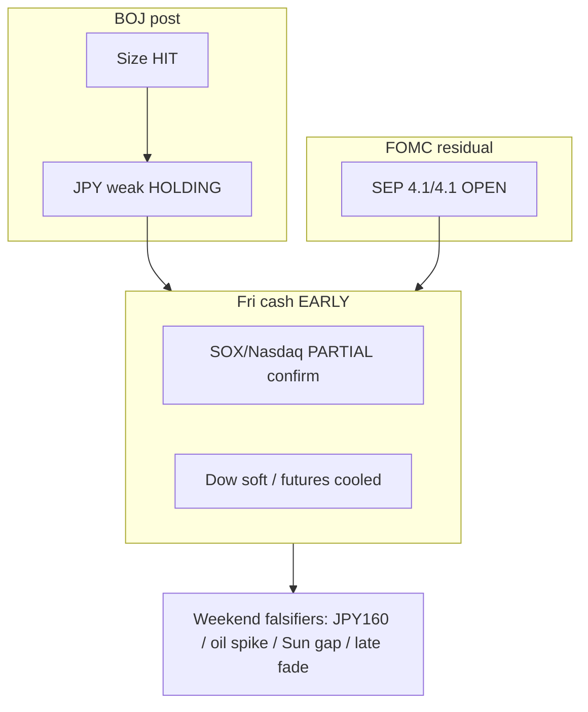

# Expectation Gap — Evening / 预期差 — 晚间

**As-of:** 2026-09-18 ~21:40 MYT  
**Lifecycle:** BOJ Sep 18 = **POST-ACTUAL**; FOMC Sep 2026 path gap **OPEN**; Fri US cash = **EARLY** (~10 min after open)  
**Claim class:** CONFIRMED / RELIABLE / INFERENCE

## A. BOJ decision gap — CLOSED on size / 日银决策差——幅度已关闭

| Item | Pre-event | Actual | Gap as of Evening |
|---|---|---|---|
| +25 bp to ~1.25% | Widely priced | **HIT** CONFIRMED 7–2 | Closed |
| JPY reaction | Many expected stronger JPY | USD/JPY **~157.8** — JPY still weak | **Opposite** near-term vs carry-unwind — **HOLDING** into cash open |
| Asia tech | Uncertain | Fri closes strong (JP/KR/TW) | Bid **LOCKED** (Asia closed) |
| US cash confirm | Hoped | Early: NQ/SOX green, Dow soft | **PARTIAL** — full session still running overnight MYT |

**Still open:** Pace into **Oct 29–30 MPM**; whether USD/JPY approaches **~160** intervention chatter over **weekend thin FX**.

## B. Residual FOMC gap / 美联储残差

| Item | Actual | Evening status |
|---|---|---|
| Binary hike +25bp | HIT 12–0 | Closed |
| SEP FF **4.1%/4.1%** | Hawkish path | **Still OPEN** — binds WACC |
| Fri cash absorption | Early tape mixed-green tech | **PARTIAL** — not full-session settle |

## C. Fri cash vs Afternoon Globex / 周五现金 vs 午后期货

| Node | Afternoon ~17:45 | Evening ~21:40 | Read |
|---|---|---|---|
| ES | ~7,722.75 (+1.08%) | ~7,709.5 (+0.91%) | Cooled — cash open digested some premium |
| NQ | ~29,868.5 (+1.43%) | ~29,815.5 (+1.25%) | Cooled modestly |
| Cash S&P | pre-open | ~7,643.6 (+0.08% vs Thu) | **Lags** futures % |
| Cash Nasdaq | pre-open | ~26,525 (+0.40%) | Partial tech confirm |
| Cash SOX | pre-open | ~11,748 (+1.28%) | Stronger confirm of semi bid |
| Oil WTI | ~95.91 (−5.9%) | ~97.58 (−4.25%) | Still <$100; **bounce** from lows |

### Thinking caption / 思维说明
1. **Observe:** BOJ size gap closed; JPY dovish-hike reaction **still holding**; Fri cash = **partial** Asia-bid confirm (semis), not broad melt-up.  
2. **Why:** Expectation-gap pack stays active into weekend — cash full-session + FX thinness matter more than early prints.  
3. **Falsifier:** Soft close Fri; intervention headlines; oil back >$100; Sunday Globex gap-down.

**What this means / 这说明什么:** Gaps = **BOJ delivery/JPY surprise still live** + **FOMC path OPEN** + **Fri cash confirmation incomplete**.
