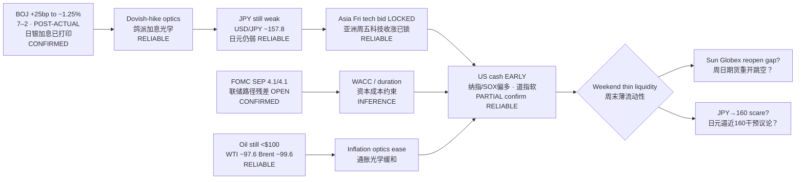

# Transmission Chain — Evening 2026-09-18 / 传导链 — 晚间

**As-of:** 2026-09-18 ~21:40 MYT  
**Claim class:** ILLUSTRATIVE structure; node facts CONFIRMED/RELIABLE as labeled  
**Source:** boj.or.jp Statement PDF k260918a + Yahoo Fri early US cash (~21:40 MYT) + Asia Fri closes + Globex

### Thinking caption / 思维说明
1. **Observe / 观察:** Afternoon thesis (BOJ dovish-hike → Asia bid → futures green) meets **early cash PARTIAL confirm**: Nasdaq/SOX green, Dow soft; cash **lags** Afternoon Globex peak (ES cooled ~7,723→~7,710).  
2. **Why it matters / 为何重要:** AI-factory Asia sleeve got Fri close green; US duration/tech needs **full-session** hold into weekend — early open ≠ settle.  
3. **Falsifier / 证伪:** Late-session fade through Thu support; USD/JPY→160 intervention scare over weekend; oil re-spike toward/above $100; Sunday Globex risk-off gap.

**What this means / 这说明什么:** Dominant theme = **BOJ dovish-hike FX still holding + semis-led early cash PARTIAL confirm of Asia bid**, with **weekend liquidity** as the next veto — not Fed-path absolution.
