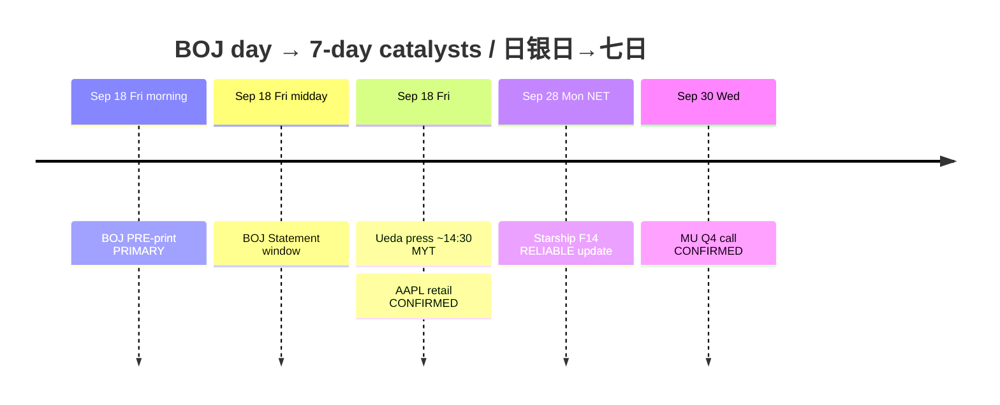

# Catalyst Timeline — Next 7 Days / 催化剂时间线（未来七日）— Morning

**As-of:** 2026-09-18 ~08:50 MYT  
**Claim class:** CONFIRMED / TENTATIVE / RUMOR / RELIABLE labeled per row  
**Session:** Morning / 早盘 — **BOJ day risks emphasized**

| Date (local) | Event | Status | Why it matters |
|---|---|---|---|
| Fri Sep 18 ~11:00–13:00 MYT | **BOJ Statement** | **CONFIRMED** calendar; print **pending** ~08:45 | **PRIMARY** Asia/FX veto — JPY speed |
| Fri Sep 18 ~14:30 MYT | Ueda press conference | **RELIABLE** wire timing | Guidance after statement |
| Fri Sep 18 | BOJ hike to ~1.25% chatter | **RUMOR / market pricing** | Not a BOJ fact |
| Fri Sep 18 (done) | Japan CPI Aug | **CONFIRMED** printed | Soft core input into BOJ |
| Fri Sep 18 all day | AAPL iPhone 18 Pro/Pro Max **retail** | **CONFIRMED** Apple Newsroom | Edge optics (secondary vs BOJ) |
| Fri Sep 18 ~21:15 MYT | Fed G.17 IP / Capacity Aug | **RELIABLE** schedule | Secondary vs BOJ |
| ~Mon Sep 28 | SpaceX **Starship Flight 14** | **RELIABLE** SpaceX NET (was Sep 22); pending regulatory | SPCX event beta — **calendar updated** |
| Wed Sep 30 2:30pm Mountain | **MU FY2026 Q4** call | **CONFIRMED** IR | HBM/memory hard print |
| Ongoing | TSLA NHTSA **AQ26002** Cybercab | **CONFIRMED** | Regulatory overhang |
| Residual | FOMC Sep path digestion | CONFIRMED decision done | 4.1/4.1 SEP still binds multiples |

### Thinking caption / 思维说明
- **Observe:** Today = **BOJ first**; AAPL retail secondary; Starship **slipped out** of this week to NET Sep 28; MU remains next hard fundamental.  
- **Why:** Avoid treating hike as decided; avoid trading Starship on stale Sep 22.  
- **Falsifier:** BOJ/JPY shock; Starship further scrub; MU guide break.

**What this means / 这说明什么:** Sequence risk = **BOJ Fri print → Ueda tone → weekend Asia FX → Starship NET Sep 28 → MU Sep 30**.
