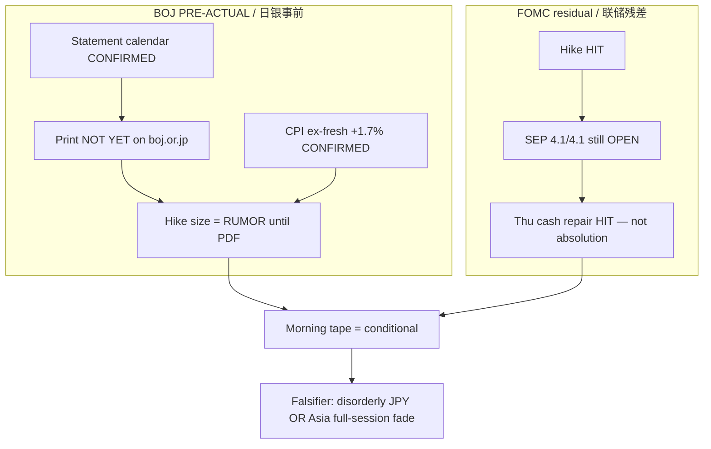

# Expectation Gap — BOJ Day PRE-ACTUAL / 预期差（早盘 · 日银事前）

**As-of:** 2026-09-18 ~08:50 MYT  
**Lifecycle:** BOJ Sep 18 = **PRE-ACTUAL** (PRIMARY); FOMC Sep 2026 = post-mortem complete (residual path gap)  
**Claim class:** CONFIRMED (calendars/CPI/Thu tape) / INFERENCE (gaps) / RUMOR (BOJ hike chatter)

## A. BOJ pre-event gap (PRIMARY today) / 日银事前预期差（今日主线）

| Item | Market / street | Official | Gap status |
|---|---|---|---|
| Meeting dates | Sep 17–18 | **CONFIRMED** BOJ schedule | None |
| Statement Friday | Expected today | **CONFIRMED** calendar; **NOT YET** on boj.or.jp ~08:45 MYT | Clock open; print pending |
| Decision window | ~11:00–13:00 MYT | RELIABLE wires (not BOJ clock) | Window RELIABLE secondary |
| Ueda press | ~14:30 MYT | RELIABLE wires | Secondary |
| +25 bp to ~1.25% | Widely discussed | **Not published** | **RUMOR/pricing** — wide if hold, narrow if hike |
| Japan CPI Aug | Soft core watched | Headline +1.9%; ex-fresh **+1.7%**; ex-f&e +1.9% | **CONFIRMED** — softens “must hike hard” optics |
| USD/JPY | 156.26 | Live Yahoo | **Speed**-sensitive into print |

## B. Residual FOMC gap / 美联储残差

| Item | Pre-event expectation | Actual | Gap |
|---|---|---|---|
| Binary hike +25bp | ~priced | +25bp 12–0 | **Closed** — HIT |
| Path / SEP | Soft-ish / cuts into 2027 | FF **4.1%/4.1%**; 16/18 ≥ another hike | **Still OPEN** hawkish residue |
| Thu cash reaction | Test Globex repair | Nasdaq +1.69% / SOX +3.14% / VIX crush | Repair **HIT** in cash — path gap not closed |

### Thinking caption / 思维说明
1. **Observe:** BOJ decision gap **OPEN**; CPI input locked soft; FOMC binary closed, path still open; Thu repair HIT.  
2. **Why:** Soft CPI can narrow hike-urgency optics without deciding the vote — wait for PDF + JPY speed.  
3. **Falsifier:** Hawkish surprise + fast JPY → risk-off re-widens; dovish/hold + slow JPY → gaps narrow into US cash.

**What this means / 这说明什么:** Expectation-gap pack is **active and BOJ-centered** until the statement prints.
