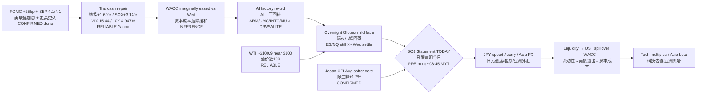

# Transmission Chain — Morning 2026-09-18 / 传导链 — 早盘

**As-of:** 2026-09-18 ~08:50 MYT  
**Claim class:** ILLUSTRATIVE structure; node facts CONFIRMED/RELIABLE as labeled  
**Source:** Yahoo Thu cash + Fri Globex/Asia; BOJ site ~08:45; Japan CPI stat.go.jp; Master Monitor  
**Dominant theme:** Thu post-FOMC repair confirmed → overnight mild fade → **BOJ PRE-print owns today’s veto** via JPY speed / carry

### Thinking caption / 思维说明
1. **Observe / 观察:** Thu repair is **Fact**; overnight fade is mild **Fact**; BOJ content is **not yet Fact**. Soft CPI is CONFIRMED input, not the decision.  
2. **Why it matters / 为何重要:** Today’s chain runs through **JPY speed** into carry/liquidity before it reaches AI multiples.  
3. **Falsifier / 证伪:** Disorderly JPY on statement → repair thesis breaks for Asia sleeve; orderly print + slow JPY → repair can extend into US premarket.

**What this means / 这说明什么:** Do not read Nasdaq +1.7% Thu as SEP absolution. Read Morning as **conditional repair pending BOJ**.
