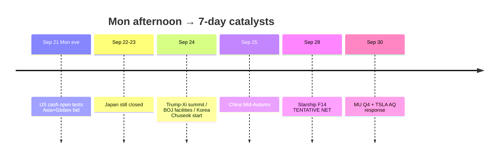

# Catalyst Timeline — Next 7 Days / 催化剂时间线

**As-of:** 2026-09-21 ~17:40 MYT  
**Session:** Afternoon / 午后 — **Asia closed**; US pre-market / Globex; Japan holiday  
**Claim class:** CONFIRMED / TENTATIVE / RUMOR labeled per row

| When | Event | Status | Why it matters / break risk |
|---|---|---|---|
| Fri Sep 18 (done) | BOJ hike ~1.25% 7–2 | **CONFIRMED** | POST-ACTUAL residual |
| Fri Sep 18 (done) | US cash — SOX +2.78% | **CONFIRMED** | Fuller semi confirm |
| Sat–Sun Sep 19–20 | Weekend FX/oil/Sun Globex | **Done** | Risk-off vetoes mostly missed |
| Sun Sep 20 | Bessent–He NY talks “successful” | **RELIABLE** wires | Tee-up; AI dialogue proposed; rare earths open |
| **Mon Sep 21 AM** | Morning Globex gap-up | **Done** | ES~7737 / NQ~30074 |
| **Mon Sep 21** | **Asia cash confirm** | **CONFIRMED** closes | KOSPI 7008 +1.65%; HSI/TW/SSE green |
| **Mon Sep 21** | Japan TSE cash CLOSED | **CONFIRMED** | Thin JP beta |
| **Mon Sep 21 eve** | **US cash session** | **CONFIRMED** schedule | **PRIMARY next** — test NQ premium |
| **Tue Sep 22** | Japan cash CLOSED (bridge) | **CONFIRMED** | Continued JP holiday |
| **Wed Sep 23** | Japan Autumnal Equinox CLOSED | **CONFIRMED** | JP cash returns Thu |
| **~Wed Sep 24** | **Trump–Xi summit** (Washington) | **RELIABLE / TENTATIVE optics** | AI/tariffs/rare earths veto |
| Wed Sep 24 | BOJ deposit/loan facilities effective | **CONFIRMED** | 1.25% / 1.5% |
| ~Thu–Fri Sep 24–25 | Korea Chuseok closes | **CONFIRMED** | KOSPI holiday cluster |
| Fri Sep 25 | China Mid-Autumn CLOSED | **CONFIRMED** | A-share holiday |
| **~Mon Sep 28** | SpaceX **Starship Flight 14** | **TENTATIVE** NET | SPCX event beta |
| **Wed Sep 30** | **MU FY2026 Q4** + TSLA AQ26002 due | **CONFIRMED** | Hard company prints |
| Oct 29–30 | Next BOJ MPM | **CONFIRMED** | Further hike pace |
| Residual | FOMC SEP 4.1/4.1 | CONFIRMED path open | WACC binds |
| Residual | US–China tariff suspension | Expires **Nov 10** | Structural cliff |

### Today’s break risks into Evening / 今日至晚间破坏点
1. US cash fades Fri support / morning Globex lows.  
2. Hard-negative Bessent–He / Trump–Xi headlines.  
3. Oil geopolitics spike back through $100.  
4. 10Y disorderly through 5%+.  
5. Thin holiday liquidity amplifies any headline.

### Thinking caption / 思维说明
- **Observe:** Hard calendar pivots from Asia confirm to **US cash tonight → summit ~Sep 24 → Starship/MU Sep 28–30**.  
- **Why:** Afternoon job = name what can break **before Evening**.  
- **Falsifier:** Orderly cash + calm oil + constructive summit optics.

**What this means / 这说明什么:** Sequence = **Mon US cash → Japan holiday Tue–Wed → Trump–Xi ~Sep 24 → Starship NET Sep 28 → MU/TSLA Sep 30**.
