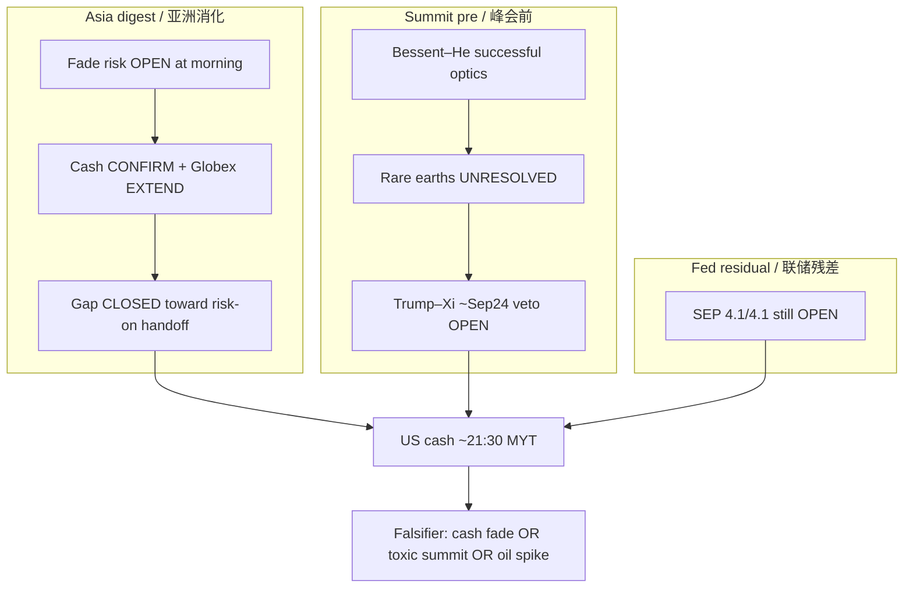

# Expectation Gap — Asia Confirm + Summit Lifecycle / 预期差

**As-of:** 2026-09-21 ~17:40 MYT  
**Lifecycle:** Weekend falsifiers = **RESOLVED (mostly missed)**; Mon Asia digest = **POST-ACTUAL confirm**; Bessent–He → Trump–Xi ~Sep 24 = **ACTIVE pre-summit**; BOJ = POST-ACTUAL residual; FOMC path gap still OPEN  
**Claim class:** CONFIRMED / RELIABLE / INFERENCE labeled

## A. Asia gap-digest gap — CLOSED toward CONFIRM / 亚洲跳空消化差——偏向确认关闭

| Item | Morning expectation left open | Afternoon actual | Gap |
|---|---|---|---|
| Asia fade of Globex gap | Possible risk | KOSPI **+1.65%** reclaim 7k; HSI/TW/SSE green | **Opposite** — confirm, not fade |
| KOSPI from LIVE ~6,944 | Digest uncertain | Close **7,007.72** | **Extended** confirm |
| Globex hold vs morning | Hold or fade | ES ~7,762 / NQ ~30,251 **above** morning | **Extended** |
| Japan beta | Offline | CLOSED CONFIRMED | Thin JP — did not block KR/TW/CN/HK bid |

## B. Summit / Bessent–He gap — OPEN / 峰会预期差——仍开

| Item | Pre-summit expectation | Latest wire | Gap |
|---|---|---|---|
| Bessent–He tone | Tee-up only | Labeled **“successful”**; AI dialogue + notification proposal | **Constructive optics** (RELIABLE) |
| Rare earths / critical minerals | Hoped progress | **Unresolved** per wires | **Still open** overhang |
| Tariff Board of Trade | Possible cuts on non-sensitive | Discussed / operationalizing | Partial — not a signed deal |
| Trump–Xi ~Sep 24 | Calendar RELIABLE | Exact optics TENTATIVE | **Headline veto LIVE** |
| Nov 10 tariff-suspension expiry | Known cliff | Unchanged | Structural residual |

## C. Residual gaps / 残差

| Item | Status |
|---|---|
| BOJ size HIT; JPY soft residual | POST-ACTUAL; USD/JPY ~157.3 |
| FOMC SEP 4.1/4.1 | **Still OPEN** — WACC bind |
| Oil <$100 hold | Holding on Yahoo Globex; geopolitics residual |

### Thinking caption / 思维说明
1. **Observe:** Asia **size/direction gap closed CONFIRM**; summit **substance gap still open** (esp. rare earths). Fed path gap open.  
2. **Why:** Afternoon green Asia/futures can still fail if cash doesn’t confirm or summit headlines turn hard-negative.  
3. **Falsifier:** Soft cash + toxic summit = risk-off; orderly cash + constructive summit = gap narrows into Tue–Wed.

**What this means / 这说明什么:** Expectation-gap pack stays **active** — Asia confirm closed one gap; **summit + Fed path** remain the live gaps. Not a skip.
