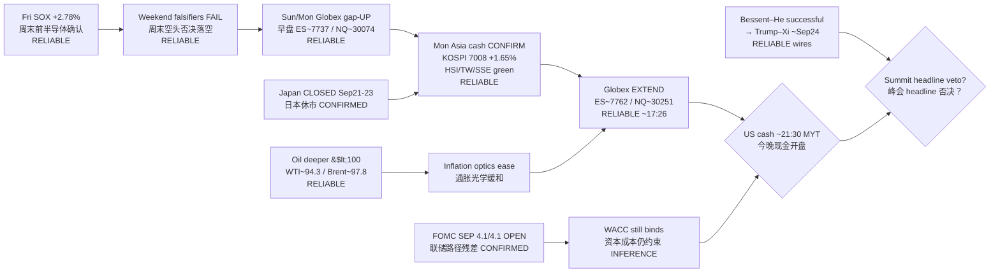

# Transmission Chain — Afternoon 2026-09-21 / 传导链 — 午后

**As-of:** 2026-09-21 ~17:40 MYT  
**Claim class:** ILLUSTRATIVE structure; node facts CONFIRMED/RELIABLE as labeled  
**Source:** Yahoo Asia closes + Globex 5m (~17:26 MYT) + Korea Herald / Focus Taiwan + Bessent–He wires + Morning continuity

### Thinking caption / 思维说明
1. **Observe / 观察:** Morning open question “will Asia fade the gap?” → **NO** — cash confirmed; Globex added premium into US pre-market.  
2. **Why it matters / 为何重要:** AI-factory hardware sleeve got **Asia validation without Japan**; next hard print is US cash + summit optics.  
3. **Falsifier / 证伪:** Cash fades Fri/morning support **or** hard-negative Trump–Xi headlines **or** oil re-spike — then “Asia confirm” node breaks into risk-off.

**What this means / 这说明什么:** Dominant theme = **Asia confirmed weekend gap + Globex extend into US pre-market**, with **summit week + Fed path** as next hinges — BOJ is residual only.
