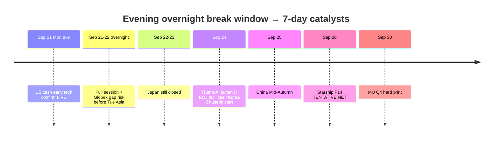

# Catalyst Timeline — Overnight Break Risks + Next 7 Days / 催化剂时间线（强调隔夜破坏）

**As-of:** 2026-09-21 ~21:55 MYT  
**Session:** Evening / 晚间 — **US cash EARLY**; Asia Mon closed/locked; Japan holiday  
**Claim class:** CONFIRMED / TENTATIVE / RUMOR labeled per row  
**Emphasis:** What can break **overnight before Tue Morning ~08:30 MYT**

| When | Event | Status | Why it matters / break risk |
|---|---|---|---|
| Fri Sep 18 (done) | BOJ hike ~1.25% 7–2 | **CONFIRMED** | POST-ACTUAL residual |
| Fri Sep 18 (done) | US cash — SOX +2.78% | **CONFIRMED** | Semi thrust started |
| Sun Sep 20 | Bessent–He NY talks “successful” | **RELIABLE** | Tee-up; AI dialogue; rare earths open |
| Mon Sep 21 | Asia cash confirm | **CONFIRMED** | KOSPI 7008 +1.65%; HSI/TW/SSE green |
| Mon Sep 21 | Japan TSE CLOSED | **CONFIRMED** | Thin JP beta through Sep 23 |
| **Mon Sep 21 ~21:30–now** | **US cash EARLY** | **LIVE RELIABLE** | Tech confirm printed — **not yet full session** |
| **Mon eve → Tue ~04:00 MYT** | **Full US cash session / close** | **LIVE** | **PRIMARY** — early green can reverse |
| **Tue ~04:00–08:30 MYT** | **Overnight Globex after US close** | **Schedule CONFIRMED** | Gap risk into Tue Asia open |
| **Anytime overnight** | Trump–Xi / rare-earths headlines | **RELIABLE calendar / LIVE risk** | Summit veto — Reuters Sep 21 rare-earth leverage color |
| **Anytime overnight** | Oil geopolitics / Mid-East | Residual | WTI now ~92.7 — re-spike veto |
| **Anytime overnight** | ARM/INTC mean-reversion cascade | LIVE tape | Extreme early leaders → SOX beta |
| Tue Sep 22 | Japan cash CLOSED (bridge) | **CONFIRMED** | Continued JP holiday |
| Wed Sep 23 | Japan Autumnal Equinox CLOSED | **CONFIRMED** | JP cash returns Thu |
| **~Thu Sep 24** | **Trump–Xi summit** (Washington) | **RELIABLE / TENTATIVE optics** | AI/tariffs/rare earths veto |
| Wed Sep 24 | BOJ facilities effective | **CONFIRMED** | 1.25% / 1.5% |
| ~Thu–Fri Sep 24–25 | Korea Chuseok closes | **CONFIRMED** | KOSPI holiday — thin KR beta |
| Fri Sep 25 | China Mid-Autumn CLOSED | **CONFIRMED** | A-share holiday |
| **~Mon Sep 28** | SpaceX **Starship Flight 14** | **TENTATIVE** NET (~08:15–09:30 ET window) | SPCX event beta |
| **Wed Sep 30** | **MU FY2026 Q4** after close | **CONFIRMED** IR | Hard company print + call 2:30 p.m. MT |
| Residual | FOMC SEP 4.1/4.1 | CONFIRMED path open | WACC binds |
| Residual | US–China tariff suspension | Expires **Nov 10** | Structural cliff |

### Overnight break risks before Tue 08:30 MYT / 周二早盘前隔夜破坏点（强调）
1. **Full Mon cash fades** early Nasdaq/SOX support into the US close (~04:00 MYT Tue).  
2. **Overnight Globex gaps down** after cash close into Tue Asia (~04:00–08:30 MYT).  
3. **Hard-negative Trump–Xi / rare-earths headlines** anytime (summit week LIVE).  
4. **Oil Mid-East re-spike** off WTI ~92.7 deep relief.  
5. **ARM (~+11%) / INTC (~+8%) cascade fade** hits SOX beta overnight.  
6. **10Y disorderly back through 5%** / USD/JPY toward 160 chatter.  
7. Thin holiday liquidity (JP closed; KR/CN holidays imminent) amplifies any headline.

### Thinking caption / 思维说明
- **Observe:** Hard calendar pivots from **cash early confirm** to **overnight hold → summit ~Sep 24 → Starship/MU Sep 28–30**.  
- **Why:** Evening job = name what can break **before next Morning run**.  
- **Falsifier:** Orderly full session + calm Globex + non-toxic summit wires.

**What this means / 这说明什么:** Sequence = **Mon cash early confirm → overnight session/Globex veto → Japan holiday Tue–Wed → Trump–Xi ~Sep 24 → Starship NET Sep 28 → MU Sep 30**.
