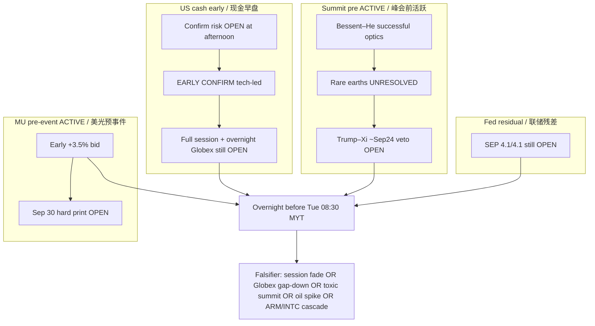

# Expectation Gap — Cash Confirm + Summit Lifecycle (ACTIVE) / 预期差

**As-of:** 2026-09-21 ~21:55 MYT  
**Lifecycle:** Weekend falsifiers = RESOLVED (missed); Mon Asia digest = POST-ACTUAL confirm; **US cash early confirm = PARTIAL POST-ACTUAL (early only)**; Bessent–He → Trump–Xi ~Sep 24 = **ACTIVE pre-summit**; MU Sep 30 = **ACTIVE pre-event**; BOJ = POST-ACTUAL residual; FOMC path gap still OPEN  
**Claim class:** CONFIRMED / RELIABLE / INFERENCE labeled

## A. US cash confirmation gap — CLOSING toward CONFIRM (early) / 现金确认差——早盘偏向确认

| Item | Afternoon expectation left open | Evening early actual | Gap |
|---|---|---|---|
| US cash confirm Asia+Globex | Open question | Nasdaq **+1.19%** / SOX **+2.25%** / QQQ **+1.59%** | **Early YES** — tech-led |
| Futures hold vs afternoon | Hold or fade | ES ~7,768 / NQ ~30,360 **≥** afternoon | **Held / extended** |
| Full-session hold | Not yet knowable | Only ~25 min printed | **Still OPEN** overnight |
| Overnight Globex | Not yet | N/A until after US close | **OPEN** into Tue Asia |

## B. Summit / Bessent–He gap — OPEN (ACTIVE) / 峰会预期差——仍开（活跃）

| Item | Pre-summit expectation | Latest wire | Gap |
|---|---|---|---|
| Bessent–He tone | Tee-up only | Labeled **“successful”**; AI dialogue proposals | Constructive optics (RELIABLE) |
| Rare earths / critical minerals | Hoped progress | **Unresolved**; Reuters Sep 21: rare earths force less-hostile US posture | **Still open** overhang — ACTIVE |
| Trump–Xi ~Sep 24 | Calendar RELIABLE | White House + state dinner this week (RELIABLE wires) | **Headline veto LIVE** |
| AI safety follow-up | Soft CapEx risk | Wire: meet again ~2 months in Shenzhen (Bessent) | New pacing optics residual |
| Nov 10 tariff-suspension expiry | Known cliff | Unchanged | Structural residual |

## C. MU pre-event gap — OPEN (ACTIVE) / 美光预事件差——仍开（活跃）

| Item | Status |
|---|---|
| MU early tape | **~+3.5%** to ~1,051.7 — bid building (RELIABLE Yahoo) |
| Hard print | **Wed Sep 30** after close (CONFIRMED IR) — call 2:30 p.m. MT |
| Prior guide framing | ~$50B ±$1B rev / ~86% GM (prior IR — not a new Mon print) |
| Gap | Price action ≠ print — **No Material = No Forced Update** on guidance |

## D. Residual gaps / 残差

| Item | Status |
|---|---|
| BOJ size HIT; JPY soft residual | POST-ACTUAL; USD/JPY ~157.4 |
| FOMC SEP 4.1/4.1 | **Still OPEN** — WACC bind |
| Oil WTI deep <$100 | Holding ~92.7; geopolitics residual |
| ARM/INTC spike durability | Extreme early — fade gap **OPEN** overnight |

### Thinking caption / 思维说明
1. **Observe:** Asia gap closed CONFIRM; US cash early gap **closing CONFIRM**; summit **substance gap still OPEN** (rare earths); MU pre-event **ACTIVE**; Fed path open.  
2. **Why:** Early green cash can still fail overnight — expectation-gap pack stays active, not skippable.  
3. **Falsifier:** Soft close + Globex gap-down + toxic summit = risk-off; orderly hold + constructive summit = gap narrows into Tue–Wed.

**What this means / 这说明什么:** Expectation-gap pack is **ACTIVE** — cash early closed one gap partially; **overnight hold + summit + MU pre-event** remain the live gaps. Not a skip.
