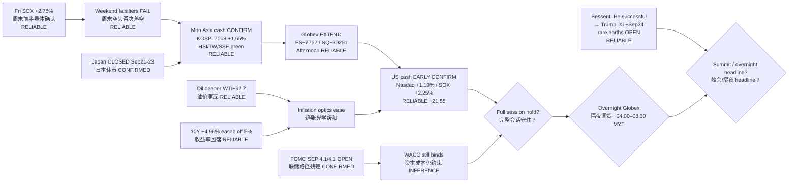

# Transmission Chain — Evening 2026-09-21 / 传导链 — 晚间

**As-of:** 2026-09-21 ~21:55 MYT  
**Claim class:** ILLUSTRATIVE structure; node facts CONFIRMED/RELIABLE as labeled  
**Source:** Yahoo US cash early + Globex (~21:45–21:55 MYT) + Mon Asia locked closes + Reuters Sep 21 rare earths/summit + Afternoon continuity

### Thinking caption / 思维说明
1. **Observe / 观察:** Afternoon open question “will US cash confirm?” → **Early YES (tech-led)**. Next open question = **hold through close + overnight Globex + summit headlines**.  
2. **Why it matters / 为何重要:** AI-factory hardware sleeve got **US cash validation**; overnight can still break the handoff before Tue Asia.  
3. **Falsifier / 证伪:** Session fade / Globex gap-down **or** hard-negative Trump–Xi headlines **or** oil re-spike / ARM–INTC cascade — then “cash confirm” node fails overnight.

**What this means / 这说明什么:** Dominant theme = **US cash early confirmed Asia+Globex tech bid**, with **overnight Globex + summit week** as next hinges — BOJ residual only.
