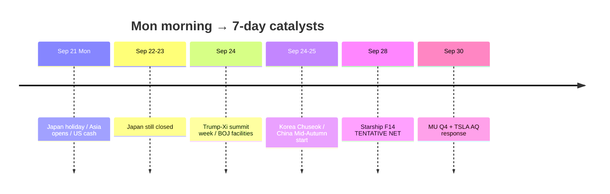

# Catalyst Timeline — Next 7 Days / 催化剂时间线

**As-of:** 2026-09-21 ~08:40 MYT  
**Session:** Morning / 早盘 — **Japan holiday**; Mon Asia open + pre-US cash  
**Claim class:** CONFIRMED / TENTATIVE / RUMOR labeled per row

| When | Event | Status | Why it matters / break risk |
|---|---|---|---|
| Fri Sep 18 (done) | BOJ hike ~1.25% 7–2 | **CONFIRMED** | POST-ACTUAL residual |
| Fri Sep 18 (done) | US cash — SOX +2.78% | **CONFIRMED** | Fuller semi confirm |
| Sat–Sun Sep 19–20 | Weekend FX/oil/Sun Globex | **Done** | Risk-off vetoes mostly missed |
| Sun Sep 20 | Bessent–He NY talks | **CONFIRMED** schedule/wires | Tee-up for leaders summit |
| **Mon Sep 21** | **Japan TSE cash CLOSED** | **CONFIRMED** | Thin JP beta; derivatives holiday trading |
| Mon Sep 21 | China/HK/MY/TW cash opens | **CONFIRMED** schedule | Digest Globex gap |
| Mon Sep 21 | US cash session | **CONFIRMED** schedule | Test NQ premium |
| **Tue Sep 22** | Japan cash CLOSED (bridge) | **CONFIRMED** | Continued JP holiday |
| **Wed Sep 23** | Japan Autumnal Equinox CLOSED | **CONFIRMED** | JP cash returns Thu |
| **~Wed Sep 24** | **Trump–Xi summit** (Washington) | **RELIABLE / TENTATIVE exact optics** | AI/tariffs/rare earths veto |
| Wed Sep 24 | BOJ deposit/loan facilities effective | **CONFIRMED** | 1.25% / 1.5% |
| ~Thu–Fri Sep 24–25 | Korea Chuseok closes | **CONFIRMED** | KOSPI holiday cluster |
| Fri Sep 25 | China Mid-Autumn CLOSED | **CONFIRMED** | A-share holiday starts |
| **~Mon Sep 28** | SpaceX **Starship Flight 14** | **TENTATIVE** NET (regulatory) | SPCX event beta |
| ~Mon Sep 29 | Micron Pre-Earnings routine | **TENTATIVE** OS routine | Setup into print |
| **Wed Sep 30** | **MU FY2026 Q4** + TSLA AQ26002 due | **CONFIRMED** | Hard company prints |
| Oct 29–30 | Next BOJ MPM | **CONFIRMED** | Further hike pace |
| Residual | FOMC SEP 4.1/4.1 | CONFIRMED path open | WACC binds |

### Today’s break risks (must-watch) / 今日破坏点
1. Asia cash (CN/HK/TW/MY) rejects Globex gap.  
2. Oil geopolitics spike back toward $100.  
3. Hard-negative Bessent–He / Trump–Xi headlines.  
4. 10Y disorderly through 5%+.  
5. CRWV dilution / Starship scrub chatter in thin JP week.

### Thinking caption / 思维说明
- **Observe:** Hard calendar pivots from BOJ/weekend to **summit week + Japan holiday cluster + Sep 28–30 company**.  
- **Why:** Morning job = name what can break **before Afternoon**.  
- **Falsifier:** Orderly Asia digest + calm oil + constructive summit optics.

**What this means / 这说明什么:** Sequence = **Mon Asia/US cash → Japan holiday Tue–Wed → Trump–Xi ~Sep 24 → Starship NET Sep 28 → MU/TSLA Sep 30**.
