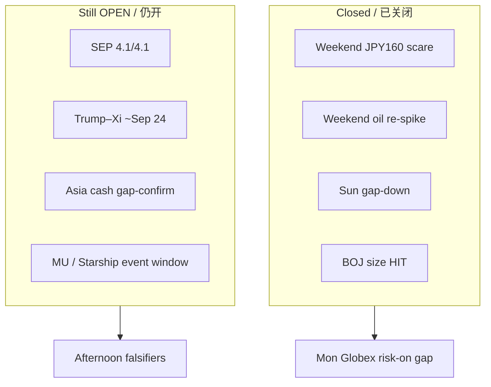

# Expectation Gap — Morning / 预期差 — 早盘

**As-of:** 2026-09-21 ~08:40 MYT  
**Lifecycle:** BOJ Sep 18 = **POST-ACTUAL**; weekend break-risk stack = **MOSTLY RESOLVED (risk-off missed)**; FOMC SEP path gap **OPEN**; Trump–Xi ~Sep 24 = **PRE-EVENT**  
**Claim class:** CONFIRMED / RELIABLE / INFERENCE

## A. Weekend falsifier gaps vs Fri Evening thesis / 周末证伪差 vs 周五晚间命题

| Evening veto | Evening fear | Mon morning outcome | Gap status |
|---|---|---|---|
| Fri late cash fade | Invalidate PARTIAL confirm | SOX **+2.78%** finish; Dow soft only | **PARTIAL miss** — semis held |
| USD/JPY → ~160 | Carry/intervention scare | USD/JPY **~156.91** | **MISSED** (opposite/firmer JPY) |
| Oil re-spike >$100 | Inflation optics reverse | WTI **~95.3** / Brent **~98.9** | **MISSED** (deeper under $100) |
| Sunday Globex gap-down | Risk-off into Mon Asia | ES/NQ **gap-UP** ~+1.0% / +1.6% | **MISSED** (opposite) |

## B. BOJ residual / 日银残差

| Item | Status |
|---|---|
| +25 bp size | Closed (HIT) |
| JPY dovish-hike weak reaction | **Moderated** Mon (~156.9 vs ~157.8 eve) — still no crisis |
| Next MPM Oct 29–30 | OPEN calendar |
| Facilities from Sep 24 | Near CONFIRMED effective date |

## C. Still-open gaps / 仍打开的缺口

| Gap | Status | Why it matters |
|---|---|---|
| FOMC SEP **4.1%/4.1%** | **OPEN** | Binds WACC / duration AI multiples |
| Trump–Xi ~Sep 24 outcomes | **PRE-EVENT** | AI/tariff/rare-earth optics |
| Asia cash confirm of Globex gap | **PENDING** (ex-Japan; CN/HK/TW/MY opens) | Handoff validity |
| MU Sep 30 / Starship NET Sep 28 | PRE-EVENT | Company event beta |

### Thinking caption / 思维说明
1. **Observe:** Expectation gap pack shifts from “will weekend break?” to “will Asia/US cash and summit confirm the repair?”  
2. **Why:** BOJ/weekend chapters mostly archived; FOMC path + summit + company calendar dominate.  
3. **Falsifier:** Asia fade; summit scare; oil geopolitics; yields disorderly.

**What this means / 这说明什么:** Closed = **weekend risk-off vetoes + BOJ size**. Open = **SEP path + summit week + Asia cash confirm + Sep 28–30 events**.
