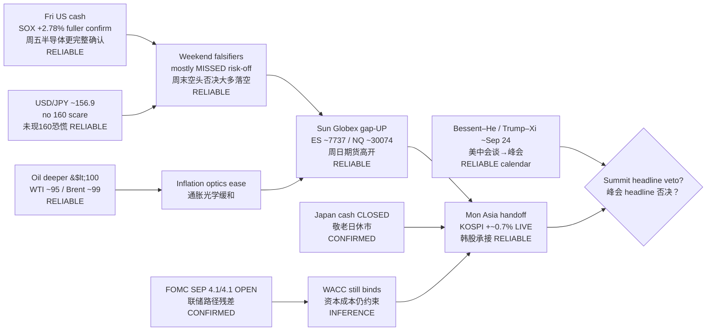

# Transmission Chain — Morning 2026-09-21 / 传导链 — 早盘

**As-of:** 2026-09-21 ~08:40 MYT  
**Claim class:** ILLUSTRATIVE structure; node facts CONFIRMED/RELIABLE as labeled  
**Source:** Yahoo Mon Globex (~08:38 MYT) + Fri US closes + Yonhap KOSPI open + Bessent–He wires + JP holiday calendars

### Thinking caption / 思维说明
1. **Observe / 观察:** Evening weekend veto stack (JPY160 / oil spike / Sun gap-down / late fade) — **three risk-off legs missed**; late fade only partial (Dow soft, semis held).  
2. **Why it matters / 为何重要:** Clears liquidity scare into Mon Asia but Japan holiday thins beta; gap still needs China/HK cash confirm.  
3. **Falsifier / 证伪:** Asia reject of gap; oil geopolitics spike; hard-negative summit headlines; 10Y disorderly >5%.

**What this means / 这说明什么:** Dominant theme = **weekend risk-off vetoes failed + Globex gap-up into Korea-led Asia (Japan closed)**, with **US–China summit week + FOMC path** as next hinges — not a BOJ reprint day.
