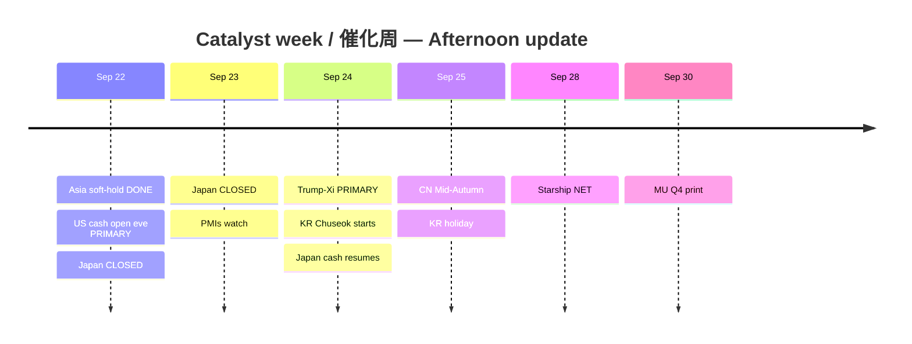

# Catalyst Timeline — 7-day / 催化剂时间线（约7日）

**As-of:** 2026-09-22 ~17:45 MYT  
**Claim class:** CONFIRMED calendars / RELIABLE wires / TENTATIVE labeled

| Date (MYT lens) | Event | Status | AI-factory relevance |
|---|---|---|---|
| **Tue Sep 22** | Japan TSE cash **CLOSED** | CONFIRMED JPX | Thins Asia beta |
| Tue Sep 22 (done) | Asia cash soft-hold (KOSPI fade from highs) | CONFIRMED closes | Digestion not cascade |
| Tue Sep 22 eve | **US cash open ~21:30 MYT** | CONFIRMED calendar | **PRIMARY next veto** |
| **Wed Sep 23** | Japan TSE cash **CLOSED** (Equinox) | CONFIRMED | Still thin JP |
| Wed Sep 23 | Eurozone/UK flash PMIs (watch) | CONFIRMED diaries | Growth vs inflation |
| **Thu Sep 24** | **Trump–Xi summit (Washington)** | RELIABLE / near-CONFIRMED | **PRIMARY veto** — tariffs, RE, AI, Nov 10 |
| Thu Sep 24 | Japan cash resumes (post-holiday) | CONFIRMED | Catch-up beta |
| Thu Sep 24–Fri Sep 25 | **Korea Chuseok holiday closes** | CONFIRMED | Liquidity risk |
| Fri Sep 25 | **China Mid-Autumn** holiday | CONFIRMED | CN liquidity thin |
| **NET ~Mon Sep 28** | SPCX Starship Flight 14 | TENTATIVE/RELIABLE | Space sleeve catalyst |
| **Wed Sep 30** | **MU FY2026 Q4 earnings** (14:30 MT) | CONFIRMED IR | Memory bottleneck print |
| Nov 10 | US–China tariff truce / RE controls cliff | CONFIRMED prior framework | Structural overhang |

### Thinking caption / 思维说明
1. **Observe:** Same-day veto shifts from Asia close → **US cash open**.  
2. **Why:** Thin holiday books amplify summit + ARM/INTC mean-reversion risk.  
3. **Falsifier:** Calendar slip on summit date or MU guidance surprise.

**What this means / 这说明什么:** Next hard nodes are **tonight’s US cash**, then **Sep 24 summit**, then **Sep 30 MU**.
