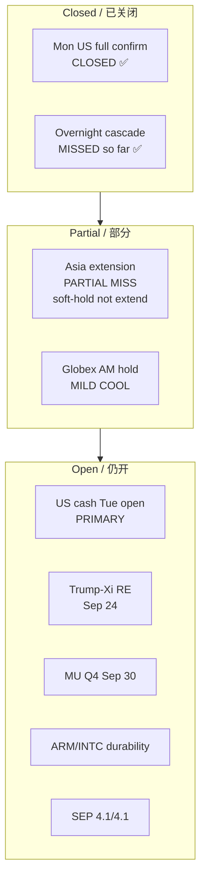

# Expectation Gap — Afternoon 2026-09-22 / 预期差 — 午后

**As-of:** 2026-09-22 ~17:45 MYT  
**Claim class:** ACTIVE event lifecycle (Trump–Xi pre-event + MU pre-event + same-day US cash gate)  
**Status:** Conceptual gap map — not a priced options surface

## Gap table / 预期差表

| Item | Prior expectation (morning) | Afternoon actual / status | Gap verdict |
|---|---|---|---|
| Asia continues overnight hold | Extension / firm green | Soft hold; KOSPI fade LIVE +1.93% → close +0.15% | **PARTIAL MISS** (no cascade, no extension) |
| Globex holds/extends AM bid | ES~7833 / NQ~30877 hold | ES~7828 / NQ~30766 cool | **MILD MISS** |
| Oil stays eased | Overnight CL~92.6 | CL~90.9 deeper | **BEAT** (more relief) |
| Trump–Xi rare earths | Unresolved overhang | Still OPEN (Reuters) | **UNCHANGED OPEN** |
| MU Sep 30 | Pre-event setup | Still OPEN (IR CONFIRMED) | **UNCHANGED OPEN** |
| ARM/INTC durability | Untested overnight | Still untested in Tue cash | **OPEN — eve first test** |
| US Tue cash confirm | Pending | Pending ~21:30 MYT | **OPEN PRIMARY** |
| FOMC SEP 4.1/4.1 | OPEN | OPEN | **UNCHANGED** |
| Overnight fade cascade | Risk named morning | Still not fired (Asia not red) | **MISS so far** |

### Thinking caption / 思维说明
1. **Observe:** Closing Mon cash gap ≠ closing summit/MU/ARM gaps. Asia “extension” gap **partially missed**.  
2. **Why:** Digestion phase raises **mean-reversion** probability into US cash without killing the Mon structural bid.  
3. **Falsifier:** Strong US open that reclaims NQ morning highs **or** toxic RE headline that gaps semis.

**What this means / 这说明什么:** Trade the **open gates** (US cash, summit, MU), not the already-closed Mon confirm.  
交易 **仍开的门**（现金、峰会、美光），不要重复交易已关闭的周一确认。

### Pre-event stubs (conceptual) / 事前预期差草稿
- **Trump–Xi:** Base = constructive optics / no RE breakthrough; Bull = RE/truce extension clarity; Bear = RE escalation / tariff threat. (ILLUSTRATIVE)  
- **MU Sep 30:** Base = beat + cautious guide; Bull = HBM upside guide; Bear = guide cut / pricing freeze. (ILLUSTRATIVE)
