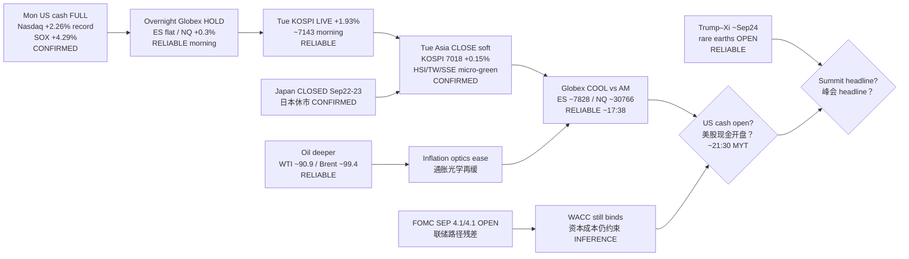

# Transmission Chain — Afternoon 2026-09-22 / 传导链 — 午后

**As-of:** 2026-09-22 ~17:45 MYT  
**Claim class:** ILLUSTRATIVE structure; node facts CONFIRMED/RELIABLE as labeled  
**Source:** Yahoo Asia closes + Globex 5m; Asiae/Korea Herald KOSPI; Reuters rare earths/summit; Morning pack continuity

### Thinking caption / 思维说明
1. **Observe / 观察:** Morning open question “Asia continue?” → **SOFT HOLD / FADE FROM HIGHS**. Globex open question “extend?” → **NO — mild cool**. Next = **US cash + summit**.  
2. **Why it matters / 为何重要:** AI-factory hardware sleeve still has **Mon cash validation**, but **Asia failed to extend** the morning LIVE premium — digestion phase.  
3. **Falsifier / 证伪:** US cash gap-down on ARM/INTC **or** toxic Trump–Xi RE wire **or** oil re-spike.

**What this means / 这说明什么:** Dominant theme = **Mon confirm → overnight hold → Asia soft digestion → Globex cool → US cash handoff**, with **summit week + holiday thinness** as next hinges.
