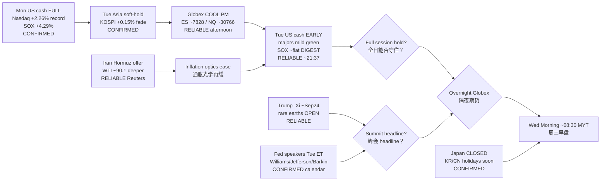

# Transmission Chain — Evening 2026-09-22 / 传导链 — 晚间

**As-of:** 2026-09-22 ~21:40 MYT  
**Claim class:** ILLUSTRATIVE structure; node facts CONFIRMED/RELIABLE as labeled  
**Source:** Yahoo US cash 1m ~21:37 MYT; Afternoon Asia/Globex continuity; Reuters Hormuz Sep 22 + rare earths/summit

### Thinking caption / 思维说明
1. **Observe / 观察:** Afternoon open question “US cash confirm?” → **EARLY DIGESTION** (majors soft green; SOX not extending).  
2. **Why it matters / 为何重要:** AI-factory sleeve survived Mon bid into Tue cash **without a second SOX thrust** — rotation to optics/networking.  
3. **Falsifier / 证伪:** Full-session fade · hawkish Fed speak · toxic Trump–Xi RE · Hormuz collapse/oil spike · Globex gap into Wed Asia.

**What this means / 这说明什么:** Dominant theme = **Mon mega-tech → Asia soft → Globex cool → Tue cash DIGEST → overnight summit/Fed/Hormuz hinges**.
