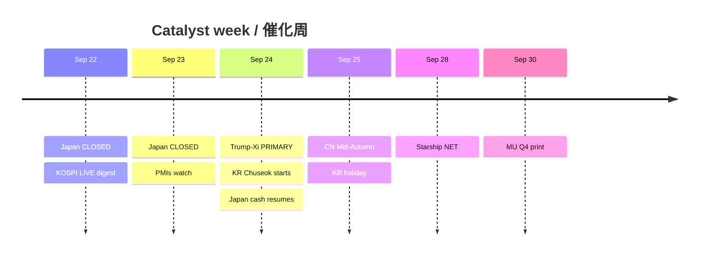

# Catalyst Timeline — 7-day / 催化剂时间线（约7日）

**As-of:** 2026-09-22 ~08:45 MYT  
**Claim class:** CONFIRMED calendars / RELIABLE wires / TENTATIVE labeled

| Date (MYT lens) | Event | Status | AI-factory relevance |
|---|---|---|---|
| **Tue Sep 22** | Japan TSE cash **CLOSED** (bridge holiday) | CONFIRMED JPX | Thins Asia beta |
| Tue Sep 22 | Japan derivatives holiday trading open | CONFIRMED JPX | Futures-only JP risk |
| Tue Sep 22 | RBA Bullock comments / thin US data | RELIABLE diaries | Secondary macro |
| Tue Sep 22 | Trump–Japan PM optics / UNGA track | RELIABLE wires | Soft diplomacy overlay |
| **Wed Sep 23** | Japan TSE cash **CLOSED** (Autumnal Equinox) | CONFIRMED | Still thin JP |
| Wed Sep 23 | Eurozone/UK flash PMIs (watch) | CONFIRMED diaries | Growth vs inflation |
| **Thu Sep 24** | **Trump–Xi summit (Washington)** | RELIABLE / near-CONFIRMED calendar | **PRIMARY veto** — tariffs, RE, AI, Nov 10 |
| Thu Sep 24 | Japan cash resumes (post-holiday) | CONFIRMED | Catch-up beta |
| Thu Sep 24–Fri Sep 25 | **Korea Chuseok holiday closes** | CONFIRMED | Liquidity risk |
| Fri Sep 25 | **China Mid-Autumn** holiday | CONFIRMED | CN liquidity thin |
| Thu Sep 24 | Nordic/Swiss rate decisions cluster | CONFIRMED diaries | Europe rates side-show |
| **NET ~Mon Sep 28** | SPCX Starship Flight 14 | TENTATIVE/RELIABLE | Space sleeve catalyst |
| **Wed Sep 30** | **MU FY2026 Q4 earnings** | CONFIRMED IR | Memory bottleneck print |
| ~Sep 30 | TSLA NHTSA AQ26002 response window | RELIABLE prior | Physical AI residual |
| Nov 10 | US–China tariff truce / RE controls cliff | CONFIRMED prior framework | Structural overhang |

### Thinking caption / 思维说明
1. **Observe:** Dense holiday cluster wraps the summit — liquidity ≠ direction.  
2. **Why:** Thin books amplify headline gaps around Trump–Xi and into MU.  
3. **Falsifier:** Calendar slip on summit date or MU guidance surprise.

**What this means / 这说明什么:** Next hard nodes are **Sep 24 summit** then **Sep 30 MU** — everything else is context or liquidity.
