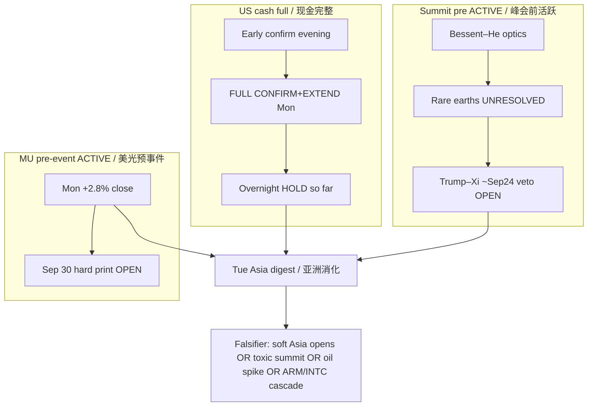

# Expectation Gap — Summit + MU Lifecycle (ACTIVE) / 预期差

**As-of:** 2026-09-22 ~08:45 MYT  
**Lifecycle:** Weekend falsifiers = RESOLVED; Mon Asia confirm = POST-ACTUAL; **US cash full confirm = POST-ACTUAL**; overnight hold = **PARTIAL POST-ACTUAL (so far)**; Bessent–He → Trump–Xi ~Sep 24 = **ACTIVE pre-summit**; MU Sep 30 = **ACTIVE pre-event**; FOMC path gap still OPEN  
**Claim class:** CONFIRMED / RELIABLE / INFERENCE labeled

## A. US cash confirmation gap — CLOSED (full session) / 现金确认差——完整会话已闭合

| Item | Evening expectation left open | Morning actual | Gap |
|---|---|---|---|
| Full-session hold | OPEN overnight | Nasdaq **+2.26% record** / SOX **+4.29%** / S&P **+1.49%** | **CLOSED — CONFIRM+EXTEND** |
| Overnight Globex | Fade risk OPEN | ES flat / NQ +0.3% | **Holding — cascade missed so far** |
| Asia Tue continuation | Unknown | KOSPI **+1.93% LIVE** | **Partial YES (Korea)**; CN/HK/TW pending |

## B. Summit / Bessent–He gap — OPEN (ACTIVE) / 峰会预期差——仍开（活跃）

| Item | Pre-summit expectation | Latest wire | Gap |
|---|---|---|---|
| Bessent–He tone | Tee-up only | “Successful”; AI dialogue; Board of Trade operational | Constructive optics (RELIABLE) |
| Rare earths / critical minerals | Hoped progress | **Unresolved** (Reuters Sep 21; Greer: want higher quantities) | **Still OPEN** — ACTIVE |
| Trump–Xi ~Sep 24 | Calendar RELIABLE | White House + state dinner this week | **Headline veto LIVE** |
| Nov 10 tariff-suspension / RE controls | Known cliff | Unchanged in reported comments | Structural residual |
| AI dialogue pacing | Soft CapEx risk | Meet again ~2 months Shenzhen (Bessent) | Residual pacing optics |

## C. MU pre-event gap — OPEN (ACTIVE) / 美光预事件差——仍开（活跃）

| Item | Status |
|---|---|
| MU Mon close | **$1,043.96 (+2.77%)** — bid held (Nasdaq API) |
| Hard print | **Wed Sep 30** after close (CONFIRMED IR) |
| Gap | Price action ≠ print — **No Material = No Forced Update** on guidance |

## D. Residual gaps / 残差

| Item | Status |
|---|---|
| ARM/INTC spike durability | Extremes (+17% / +12%) — fade gap **still OPEN** into US cash |
| Japan holiday thinness | CONFIRMED through Sep 23 |
| Korea Chuseok Sep 24–25 | Liquidity risk ahead CONFIRMED |
| FOMC SEP 4.1/4.1 | **Still OPEN** — WACC bind |
| Oil geopolitics | Settles deep; Iran/UNGA residual |

### Thinking caption / 思维说明
1. **Observe:** Cash full gap **closed**; overnight hold **partial**; summit **substance gap still OPEN**; MU pre-event **ACTIVE**.  
2. **Why:** Closing one gap does not close the catalyst gaps — pack stays required.  
3. **Falsifier:** Soft Asia + toxic summit = risk-off; orderly Asia + constructive summit = gaps narrow into Wed–Thu.

**What this means / 这说明什么:** Expectation-gap pack is **ACTIVE** — cash confirm closed; **summit + MU + post-spike durability** remain the live gaps.
