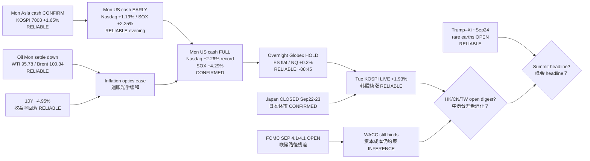

# Transmission Chain — Morning 2026-09-22 / 传导链 — 早盘

**As-of:** 2026-09-22 ~08:45 MYT  
**Claim class:** ILLUSTRATIVE structure; node facts CONFIRMED/RELIABLE as labeled  
**Source:** Yahoo overnight + KOSPI live; Nasdaq/CNBC Mon full closes; Reuters rare earths/summit; JPX calendars

### Thinking caption / 思维说明
1. **Observe / 观察:** Evening open question “full session hold?” → **YES and stronger**. Overnight open question “fade?” → **NO so far**. Next = **Asia ex-Japan digest + summit**.  
2. **Why it matters / 为何重要:** AI-factory hardware sleeve now has **full US cash validation + overnight hold**; holiday-thinned Asia can still break the chain.  
3. **Falsifier / 证伪:** Soft HSI/SSE/TW opens **or** toxic Trump–Xi wire **or** oil re-spike / ARM–INTC cascade into US cash.

**What this means / 这说明什么:** Dominant theme = **full-session confirm → overnight hold → Korea continuation**, with **summit week + Japan holiday thinness** as next hinges.
