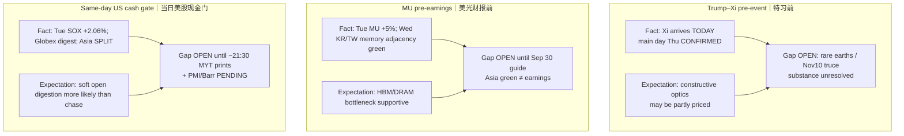

# Expectation Gap — Afternoon 2026-09-23 / 预期差 — 午后

**Status:** **ACTIVE**  
**As-of:** 2026-09-23 ~17:45 MYT  
**Nodes:** (1) Trump–Xi pre-event / arrival day (2) MU pre-earnings (3) same-day US cash gate (+ PMI/Barr PENDING)

## Gap map / 预期差图

## Explicit gaps / 明确缺口

| Node | Fundamental expectation | Market pricing (inferred) | Gap | Falsifier |
|---|---|---|---|---|
| Trump–Xi | RE licences / truce clarity needed for supply assurance | Constructive protocol/optics may be partially in | **Substance vs optics** still OPEN | Toxic RE/tariff headline Thu |
| MU | Bottleneck growth into Q4 print | Tue +5% + Asia memory adjacency | **Pre-event premium vs guide risk** | Guide miss / cut Sep 30 |
| US cash Wed | Digestion of Tue semi bid after Asia SPLIT | Globex ES firm / NQ cool = mild | **Open print unknown** | Gap-down cascade on stretched RSI names |

### Thinking Tutorial / 思维教程
1. **Observe:** Three ACTIVE gaps — do not collapse into one “risk-on” label.  
2. **Why:** Asia SPLIT already showed hardware ≠ software beta.  
3. **Evidence:** KOSPI/TW green vs HSI/A red; NQ cool vs ES firm.  
4. **Transmission:** Gaps resolve at **US cash / PMI-Barr / Thu summit / Sep 30 MU** — not at afternoon Asia close.  
5. **Alternative:** Soft PMI + patient Barr + constructive RE wire could extend conditional risk-on.  
6. **Falsifier:** Hawkish Barr + hot PMI + toxic RE = multiple compression.  
7. **Watch next:** 21:30 MYT cash open → 21:45 PMI → 22:05 Barr → Thu summit.

**What this means / 这说明什么:** Afternoon closes Asia claim-class; **does not** close summit, MU, or Wed US cash gaps.
