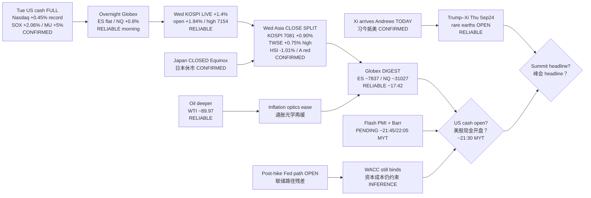

# Transmission Chain — Afternoon 2026-09-23 / 传导链 — 午后

**As-of:** 2026-09-23 ~17:45 MYT  
**Claim class:** ILLUSTRATIVE structure; node facts CONFIRMED/RELIABLE as labeled  
**Dominant theme:** Trump–Xi arrival→summit / rare earths OPEN + AI-factory SOX continuation into Asia SPLIT close + Barr/PMI PENDING  
**Source:** Yahoo Globex/Asia; Edaily KOSPI; Focus Taiwan TWSE; Futunn HSI; 金投 SSE/CSI300; Reuters oil/summit; Morning continuity

### Thinking caption / 思维说明
1. **Observe / 观察:** Morning open question “Asia continue?” → **SPLIT soft-hold** (KR/TW yes; HK/A no). Globex “extend NQ?” → **NO — mild cool**; ES mild firm. Next = **US cash + PMI/Barr + Thu summit**.  
2. **Why it matters / 为何重要:** AI-factory hardware sleeve has **Tue cash + Wed KR/TW validation**, but **HK software fade** warns multiple caution; summit RE gap still **OPEN**.  
3. **Falsifier / 证伪:** US cash gap-down on MU/ARM/INTC **or** toxic Trump–Xi RE wire **or** oil re-spike **or** hawkish Barr + hot PMI combo.

**What this means / 这说明什么:** Dominant theme = **Tue SOX/MU → overnight NQ → Wed Asia SPLIT → Globex digest → US cash + summit veto**.
