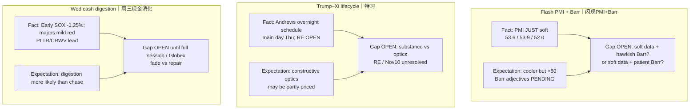

# Expectation Gap — Evening 2026-09-23 / 预期差 — 晚间

**Status:** **ACTIVE**  
**As-of:** 2026-09-23 ~21:45 MYT  
**Nodes:** (1) PMI/Barr same-evening window (2) Trump–Xi overnight→Thu (3) Wed cash soft open vs Tue SOX digestion

## Gap map / 预期差图

## Explicit gaps / 明确缺口

| Node | Fundamental expectation | Market pricing (inferred) | Gap | Falsifier |
|---|---|---|---|---|
| PMI/Barr | Soft activity + still-elevated costs → path wait | Soft PMI in; Barr not yet | **Reaction function OPEN** | Hawkish Barr re-prices yields/tech |
| Trump–Xi | RE licences / truce clarity needed | Protocol/optics may be partially in | **Substance vs optics** still OPEN | Toxic RE/tariff headline Thu |
| Wed cash | Digestion of Tue semi bid after Asia SPLIT | Early SOX −1.25% = fade bid | **Full-session / overnight hold** | Cascade gap-down Globex |

### Thinking Tutorial / 思维教程
1. **Observe:** Three ACTIVE gaps — PMI reaction, summit substance, cash fade durability.  
2. **Why:** Soft PMI without Barr yet = incomplete same-evening macro close.  
3. **Evidence:** SOX −1.25% + PMI 53.6 + Barr PENDING + RE OPEN.  
4. **Transmission:** Gaps resolve at **Barr / Wed close-Globex / Thu summit** — not at early cash alone.  
5. **Alternative:** Patient Barr + constructive RE could repair SOX overnight.  
6. **Falsifier:** Hawkish Barr + toxic RE + 10Y >5% = multiple compression into Morning.  
7. **Watch next:** 22:05 Barr → US close → Andrews ~04:10 Thu MYT → Thu Morning Asia (KR closed).

**What this means / 这说明什么:** Evening **closes** early-cash and PMI print claim-class; **does not** close Barr, summit substance, or overnight Globex gaps.
