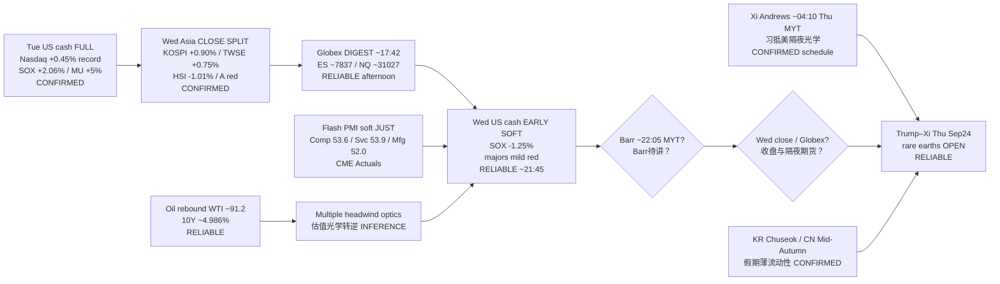

# Transmission Chain — Evening 2026-09-23 / 传导链 — 晚间

**As-of:** 2026-09-23 ~21:45 MYT  
**Claim class:** ILLUSTRATIVE structure; node facts CONFIRMED/RELIABLE as labeled  
**Dominant theme:** Wed US cash soft open / SOX digestion + soft Flash PMI JUST printed + Barr PENDING → overnight Trump–Xi / holiday-thin Asia  
**Source:** Yahoo Wed cash 1m; Reuters open; CME Econoday PMI Actuals; Fed calendar; Afternoon Asia lock; summit wires

### Thinking caption / 思维说明
1. **Observe / 观察:** Afternoon open question “US cash confirm?” → **Early = soft NO on SOX**; PMI soft JUST in; Barr still open; next = overnight summit/holiday.  
2. **Why it matters / 为何重要:** AI-factory hardware sleeve loses **early cash confirmation**; software/cloud (PLTR/CRWV) rotates; summit RE gap still **OPEN**.  
3. **Falsifier / 证伪:** Cash repairs + patient Barr + constructive RE **or** hawkish Barr + toxic RE + SOX overnight cascade.

**What this means / 这说明什么:** Dominant theme = **Tue SOX/MU → Asia SPLIT → Globex digest → Wed cash SOFT + soft PMI → Barr/overnight Trump–Xi veto**.
