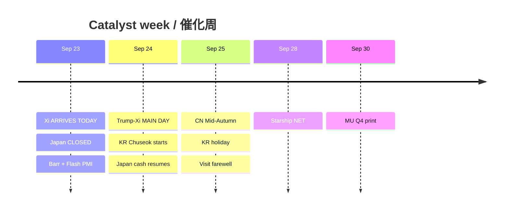

# Catalyst Timeline — 7-day / 催化剂时间线（约7日）

**As-of:** 2026-09-23 ~08:46 MYT  
**Claim class:** CONFIRMED calendars / RELIABLE wires / TENTATIVE labeled  
**Source:** Master Event Monitor 2026-09-23; White House; Fed; BOJ; S&P PMI; IR

| Date (MYT lens) | Event | Status | AI-factory relevance |
|---|---|---|---|
| **Wed Sep 23 (TODAY)** | **Xi arrives Joint Base Andrews** | CONFIRMED White House | **Event-vol LIVE** — logistics for Thu |
| Wed Sep 23 | Japan TSE cash **CLOSED** (Equinox) | CONFIRMED JPX | Thins Asia beta |
| Wed Sep 23 | S&P Global Flash US PMI ~9:45 ET | CONFIRMED | Growth/inflation optics |
| Wed Sep 23 | Fed Gov Barr ~10:05 ET (Chicago Fed) | CONFIRMED Fed | Reaction-function watch |
| Wed Sep 23 | EZ/UK Flash PMI cluster | CONFIRMED | Light–medium global growth |
| **Thu Sep 24** | **Trump–Xi White House MAIN DAY** | CONFIRMED logistics; agenda RELIABLE | **PRIMARY veto** — RE, truce, AI, Taiwan, Iran |
| Thu Sep 24 | Japan cash resumes; BOJ rates effective | CONFIRMED | Catch-up beta + JPY path |
| Thu Sep 24 | BEA Int'l Transactions; New Home Sales; SCOOS | CONFIRMED | Macro side-show |
| Thu Sep 24–Fri Sep 25 | **Korea Chuseok holiday closes** | CONFIRMED | Liquidity risk |
| Fri Sep 25 | Trump–Xi farewell / National Archives | CONFIRMED | End of state visit |
| Fri Sep 25 | **China Mid-Autumn**; Durable Goods | CONFIRMED | CN liquidity thin |
| **NET ~Mon Sep 28** | SPCX Starship Flight 14 | TENTATIVE/RELIABLE | Space sleeve catalyst |
| **Wed Sep 30** | **MU FY2026 Q4 earnings** | CONFIRMED IR | Memory bottleneck print |
| Sep 30 | BEA PCE + GDP third estimate | CONFIRMED | Macro hinge |
| Nov 10 | US–China tariff truce / RE controls cliff | CONFIRMED prior framework | Structural overhang |

### Thinking caption / 思维说明
1. **Observe:** Summit lifecycle **upgraded from calendar to arrival-day LIVE**.  
2. **Why:** Thin holiday books amplify headline gaps around Xi arrival → Thu main day → into MU.  
3. **Falsifier:** Calendar slip (unlikely) or substance surprise (RE hard-negative / hard-positive).

**What this means / 这说明什么:** Next hard nodes are **today arrival optics → Thu summit substance → Sep 30 MU** — everything else is context or liquidity.
