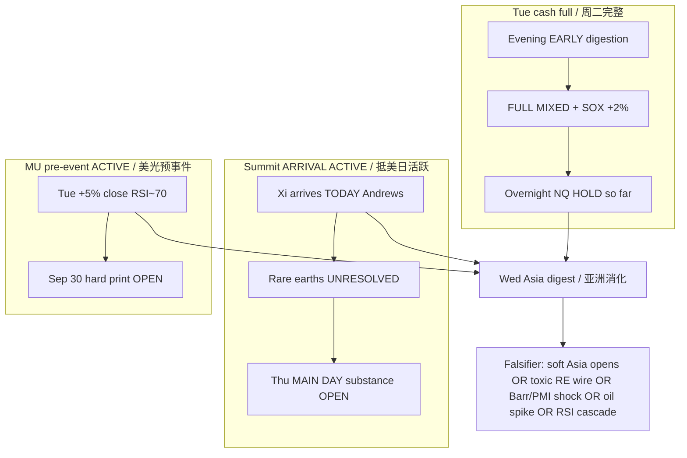

# Expectation Gap — Summit Lifecycle + MU (ACTIVE) / 预期差

**As-of:** 2026-09-23 ~08:46 MYT  
**Lifecycle:** Mon cash full confirm = POST-ACTUAL; Tue early digestion = POST-ACTUAL evening; **Tue full cash = POST-ACTUAL mixed+SOX skew**; overnight hold = **PARTIAL POST-ACTUAL (so far)**; **Xi arrives TODAY = ACTIVE arrival day**; Trump–Xi Thu main = **ACTIVE pre-summit substance**; MU Sep 30 = **ACTIVE pre-event**  
**Claim class:** CONFIRMED / RELIABLE / INFERENCE labeled

## A. Tue cash digestion gap — CLOSED (with SOX skew) / 周二消化差——已闭合（含SOX偏斜）

| Item | Evening expectation left open | Morning actual | Gap |
|---|---|---|---|
| Full-session digestion | OPEN overnight | Dow **−0.36%** / S&P flat / Nasdaq **+0.45% record** / SOX **+2.06%** | **CLOSED — MIXED + SOX CONTINUATION** |
| Overnight Globex | Fade/cascade risk OPEN | ES flat / NQ **+0.82%** | **Holding — cascade missed so far** |
| Asia Wed continuation | Unknown | KOSPI **~+1.4% LIVE** | **Partial YES (Korea)**; CN/HK/TW pending |

## B. Summit / Trump–Xi gap — OPEN (ACTIVE — arrival day) / 峰会预期差——仍开（活跃——抵美日）

| Item | Pre-summit expectation | Latest wire | Gap |
|---|---|---|---|
| Logistics dates | RELIABLE → CONFIRMED | White House: Xi **Wed Sep 23** Andrews; main **Thu Sep 24**; farewell Fri 25 | **Arrival day LIVE** |
| Protocol optics | Standard White House greet | Trump **personal airport greeting** unusual | Optics constructive (RELIABLE) |
| Rare earths / critical minerals | Hoped progress | Still **OPEN** — RE leverage keeps US less hostile (Reuters Sep 21); no export-control ease expected | **Still OPEN** — ACTIVE |
| Tariff truce ~Nov 10 | Extension hoped | Unchanged cliff | Structural residual |
| AI / Taiwan / Iran | Soft CapEx / geo overlay | On agenda; deliverables split among watchers (ABC Sep 23) | Substance gap OPEN |
| Grand bargain | Low probability prior | Still not base case | Expectation vs hope |

## C. MU pre-event gap — OPEN (ACTIVE) / 美光预事件差——仍开（活跃）

| Item | Status |
|---|---|
| MU Tue close | **$1,096.16 (+5.00%)** — bid accelerated (Yahoo) |
| RSI14 | **~70.1** — stretched into event |
| Hard print | **Wed Sep 30** after close (CONFIRMED IR) |
| Gap | Price action ≠ print — **No Material = No Forced Update** on guidance |

## D. Residual gaps / 残差

| Item | Status |
|---|---|
| ARM/INTC durability | Still green Tue (+3.2% / +1.7%) but RSI ~79/80 — fade gap **OPEN** |
| LITE 1D fade | Evening early leader → full −0.92% — optical momentum gap **OPEN** |
| Japan holiday thinness | CONFIRMED through Sep 23; resumes Thu |
| Korea Chuseok Sep 24–25 | Liquidity risk ahead CONFIRMED |
| Barr / Flash PMI today | Watch until surprise — not priced as Master alert |
| Oil geopolitics | Deeper ~90/99; Hormuz offer **conditional / archived** |
| FOMC path / WACC | Still binds (Inference) |

### Thinking caption / 思维说明
1. **Observe:** Tue cash digestion gap **closed with SOX skew**; overnight hold **partial**; summit **moved from calendar to ARRIVAL DAY**; MU pre-event **ACTIVE and hotter (+5%)**.  
2. **Why:** Closing the cash-label gap does not close catalyst gaps — pack stays required, especially with Xi on the ground today.  
3. **Falsifier:** Soft Asia + toxic RE on arrival = risk-off; orderly Asia + constructive arrival optics = gaps narrow into Thu main day.

**What this means / 这说明什么:** Expectation-gap pack is **ACTIVE** — Tue cash label closed; **summit arrival→substance + MU + post-spike RSI durability** remain the live gaps.
