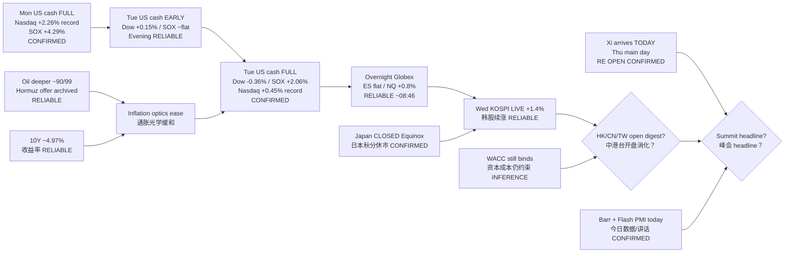

# Transmission Chain — Morning 2026-09-23 / 传导链 — 早盘

**As-of:** 2026-09-23 ~08:46 MYT  
**Claim class:** ILLUSTRATIVE structure; node facts CONFIRMED/RELIABLE as labeled  
**Source:** Yahoo Tue full + overnight; KOSPI live; Master monitor; White House summit logistics

### Thinking caption / 思维说明
1. **Observe / 观察:** Evening open question “full digestion?” → **YES with SOX positive skew**. Overnight “fade cascade?” → **NO so far (NQ bid)**. Next = **Asia ex-Japan digest + Xi-arrival day**.  
2. **Why it matters / 为何重要:** AI-factory hardware sleeve has **Tue SOX/memory continuation + overnight NQ hold**; holiday-thinned Asia + summit arrival can still break the chain.  
3. **Falsifier / 证伪:** Soft HSI/SSE/TW opens **or** toxic RE wire on arrival **or** oil re-spike / RSI cascade into US cash.

**What this means / 这说明什么:** Dominant theme = **full-session mixed digestion → SOX continuation → overnight NQ hold → Korea continuation**, with **Xi-arrival day + Japan holiday thinness** as next hinges.
