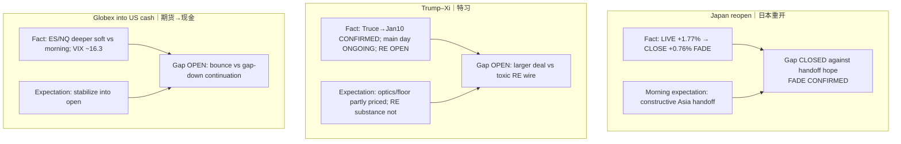

# Expectation Gap — Afternoon 2026-09-24 / 预期差 — 午后

**Status:** **ACTIVE** (Trump–Xi lifecycle + rates handoff)  
**As-of:** 2026-09-24 ~17:40 MYT (Asia/Kuala_Lumpur)  
**Nodes:** (1) Japan reopen handoff falsified (2) Truce floor vs RE substance (3) Globex deeper soft into US cash

| Node | Fundamental expectation | Market pricing (inferred) | Gap | Falsifier |
|---|---|---|---|---|
| JP handoff | Reopen strength cushions rates shock | Close faded; A-shares hard | **CLOSED (fade)** | N/A — already faded |
| Trump–Xi | RE/truce clarity | Floor (Jan10) in; RE open | **Substance vs floor** | Signed RE relief **or** toxic wire |
| Globex→cash | Soft Globex digests into open | Deeper soft + VIX up | **Continuation vs bounce** | ES/NQ reclaim morning levels into cash |

### Thinking Tutorial / 思维教程
1. **Observe:** Morning Japan LIVE premium **did not** survive Asia FULL close.  
2. **Why:** Rates shock + Greater China caution dominated local reopen bid.  
3. **Evidence:** Nikkei high 66,249 → close 65,514; SSE −1.22%; CSI −1.73%; Globex ES 7725 / NQ 30442.  
4. **Transmission:** Gaps now resolve at **US cash open + summit formal wires**.  
5. **Alternative:** Constructive dinner optics could still bounce Globex into open despite Asia fade.  
6. **Falsifier:** Printed RE deal beyond truce floor — then upgrade claim class.  
7. **Watch next:** US cash ~21:30 MYT → summit dinner headlines → Evening report.

**What this means / 这说明什么:** Afternoon **closes** the Japan-handoff hope and **leaves OPEN** RE substance + US cash reaction to Wed rates shock.
