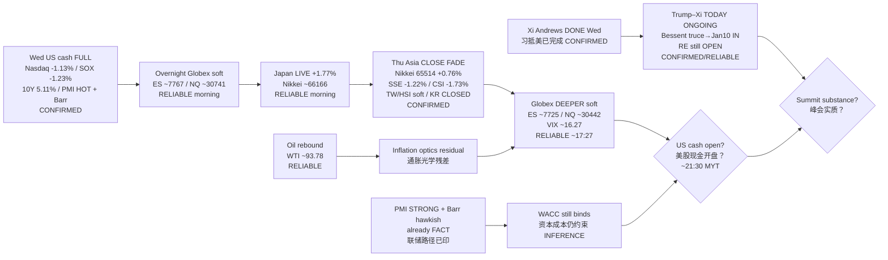

# Transmission Chain — Afternoon 2026-09-24 / 传导链 — 午后

**As-of:** 2026-09-24 ~17:40 MYT  
**Claim class:** ILLUSTRATIVE structure; node facts CONFIRMED/RELIABLE as labeled  
**Dominant theme:** Rates-digestion handoff FADE + Trump–Xi truce floor / RE OPEN + Asia→US cash  
**Source:** Yahoo Globex/Asia ~17:27–17:40 MYT; TE HSI/SSE/CSI300; Reuters/NBC/BI Bessent+RE; Morning continuity

### Thinking caption / 思维说明
1. **Observe / 观察:** Morning open question “Japan handoff?” → **FADE**. Globex “stabilize?” → **NO — deeper soft**. Summit “close RE?” → **NO — floor only via truce extension**.  
2. **Why it matters / 为何重要:** AI-factory hardware sleeve lost Asia cushion; rates shock still binds into US cash; RE leverage unresolved.  
3. **Falsifier / 证伪:** US cash bounce reclaiming Wed closes **or** signed RE relief beyond truce floor **or** oil fade + VIX drop.

**What this means / 这说明什么:** Dominant theme = **Wed rates digestion → soft Globex → JP LIVE fade → Asia FADE → deeper Globex → US cash + summit RE veto**.
