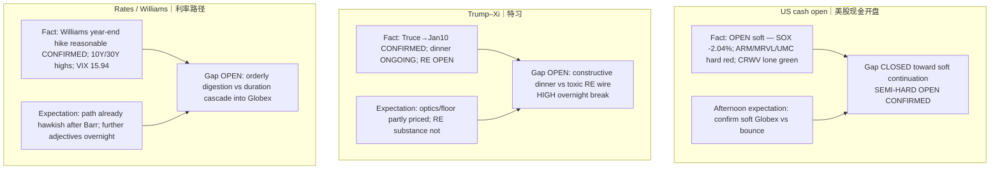

# Expectation Gap — Evening 2026-09-24 / 预期差 — 晚间

**Status:** **ACTIVE** (Trump–Xi lifecycle + rates lifecycle)  
**As-of:** 2026-09-24 ~21:30 MYT (Asia/Kuala_Lumpur)  
**Nodes:** (1) US cash open vs afternoon soft Globex (2) Truce floor vs RE substance (3) Rates/Williams path into overnight

| Node | Fundamental expectation | Market pricing (inferred) | Gap | Falsifier |
|---|---|---|---|---|
| US cash open | Soft Globex digests into open | OPEN soft; SOX −2.04% harder | **CLOSED (soft continuation)** | Full-session reclaim of Wed closes |
| Trump–Xi | RE/truce clarity | Floor (Jan10) in; RE open; dinner pending | **Substance vs floor — OPEN overnight** | Signed RE relief **or** toxic wire |
| Rates / Williams | Hawkish path after Barr/PMI HOT | Williams “reasonable” hike; yields highs | **Orderly vs cascade — OPEN** | Yield fade / patient path language |

### Thinking Tutorial / 思维教程
1. **Observe:** Afternoon’s “will cash confirm soft?” is **answered YES** at open — SOX harder than Wed FULL.  
2. **Why:** Rates shock + Williams path + oil elevated dominate AI CapEx multiple optics at the open print.  
3. **Evidence:** SOX 12,278.85 (−2.04%); ARM −4.30%; MRVL −3.03%; UMC −2.67%; CRWV +1.74%; 10Y wire high 5.133%; WTI 93.62.  
4. **Transmission:** Open gap **closes** soft-continuation; RE + rates gaps **remain OPEN** into overnight dinner/Globex.  
5. **Alternative:** Constructive dinner optics + SOX stabilize could still repair into close despite hard open.  
6. **Falsifier:** Printed RE deal beyond truce floor — then upgrade claim class; OR toxic RE + SOX cascade overnight.  
7. **Watch next:** Full Thu session → dinner/readouts overnight → Fri Morning under KR Chuseok + CN Mid-Autumn dark.

**What this means / 这说明什么:** Evening **closes** the US-cash soft-vs-bounce question toward **soft continuation / semi-hard open**, and **leaves OPEN** RE substance + rates/Williams overnight residual — both **ACTIVE** expectation gaps into Fri.
