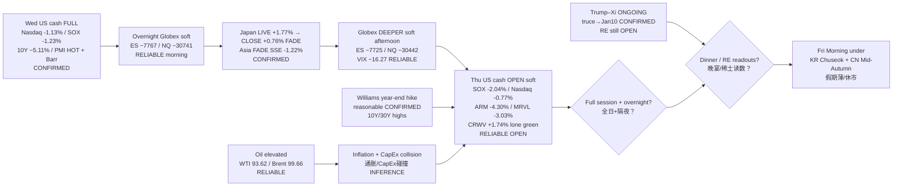

# Transmission Chain — Evening 2026-09-24 / 传导链 — 晚间

**As-of:** 2026-09-24 ~21:30 MYT  
**Claim class:** ILLUSTRATIVE structure; node facts CONFIRMED/RELIABLE as labeled  
**Dominant theme:** Rates-shock CONTINUATION / SEMI-HARD OPEN + Trump–Xi dinner/RE overnight break  
**Source:** Yahoo/CNBC OPEN ~21:30–21:32 MYT; Afternoon continuity; Reuters/Politico/Hill/WaPo Bessent+RE; Williams CNBC

### Thinking caption / 思维说明
1. **Observe / 观察:** Afternoon open question “US cash confirm soft?” → **YES — soft continuation; SOX harder (−2.04%)**. Summit “close RE?” → **still NO — floor only**.  
2. **Why it matters / 为何重要:** AI-factory hardware sleeve lost the cash repair hope at open; rates + Williams still bind; RE leverage unresolved into dinner.  
3. **Falsifier / 证伪:** Full-session bounce reclaiming Wed closes **or** signed RE relief beyond truce floor **or** oil fade + VIX drop + SOX stabilize.

**What this means / 这说明什么:** Dominant theme = **Wed rates digestion → Asia FADE → soft Globex → Thu OPEN soft/semi-hard → overnight Trump–Xi dinner/RE + rates residual → Fri holiday thin**.
