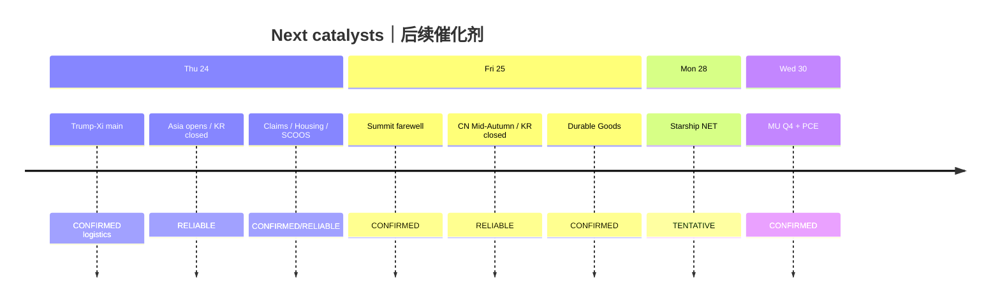

# Catalyst Timeline — Morning 2026-09-24 / 催化剂时间线 — 早盘

**As-of:** 2026-09-24 ~08:46 MYT (Asia/Kuala_Lumpur)  
**Horizon:** ~7 days through ~2026-10-01  
**Claim rule:** CONFIRMED / TENTATIVE / RUMOR

| When (MYT) | Event | Class | Materiality | Note |
|---|---|---|---|---|
| **Thu Sep 24 all day** | **Trump–Xi White House main day** | CONFIRMED logistics; substance OPEN | **HIGH** | Rare earths / truce / AI |
| Thu Sep 24 ~09:00 | TWSE open (after night fut −403) | RELIABLE | Medium | Semi tone |
| Thu Sep 24 ~09:00–09:30 | KLCI / HSI / SSE opens | RELIABLE | Medium | Greater China |
| Thu Sep 24 | Korea Chuseok **CLOSED** | RELIABLE | Medium | Thin KR AI-chain |
| Thu Sep 24 | BOJ rates **effective** (1.25%/1.5%) | CONFIRMED | Light | Known since Sep 18 |
| Thu ~20:30 | US Initial Claims (typical) | RELIABLE | Medium | Labor |
| Thu ~22:00 | New Residential Sales Aug | CONFIRMED | Light–med | Housing / Barr theme |
| Thu ~02:00 Fri | Fed SCOOS | CONFIRMED | Medium | Dealer leverage |
| **Fri Sep 25** | Trump–Xi farewell / Archives AM | CONFIRMED logistics | Medium | End of visit |
| Fri Sep 25 | China Mid-Autumn | RELIABLE | Medium | Asia liquidity |
| Fri Sep 25 | KR Chuseok continues CLOSED | RELIABLE | Medium | |
| Fri Sep 25 | US Durable Goods Aug 20:30 MYT | CONFIRMED | Medium | |
| **Mon Sep 28** | Starship Flight 14 NET | TENTATIVE / RELIABLE | Medium–High for SPCX | Reconfirm day-of |
| Wed **Sep 30** | **MU FY2026 Q4** after close | CONFIRMED IR | **HIGH** | ~04:30 MYT Oct 1 call |
| Wed Sep 30 | PCE / GDP third (BEA) | CONFIRMED | HIGH macro | |
| ~Sep 25 | AAPL 2nd-wave iPhone | TENTATIVE | Medium | |
| ~Sep 30 | TSLA Special Order | TENTATIVE | Medium | |
| Oct 27–28 | Next FOMC | CONFIRMED | HIGH | |
| Oct 29–30 | Next BOJ MPM | CONFIRMED | HIGH | |

**Thinking caption:** Primary near veto = **today’s summit substance**; primary company veto into month-end = **MU Sep 30**.
