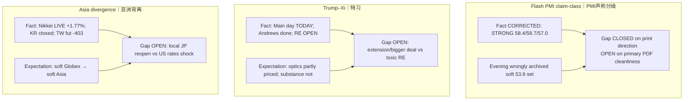

# Expectation Gap — Morning 2026-09-24 / 预期差 — 早盘

**Status:** **ACTIVE**  
**As-of:** 2026-09-24 ~08:46 MYT (Asia/Kuala_Lumpur)  
**Nodes:** (1) PMI claim-class correction (2) Barr residual into claims/housing (3) Trump–Xi substance vs optics (4) Japan reopen vs soft Globex

| Node | Fundamental expectation | Market pricing (inferred) | Gap | Falsifier |
|---|---|---|---|---|
| PMI/Barr | Strong activity → harder Fed path | 10Y ~5.11%; Nasdaq −1.13% | **Path adjectives residual** | Soft claims + patient Fed speak |
| Trump–Xi | RE/truce clarity needed | Protocol may be partly in | **Substance vs optics** | Signed RE relief **or** toxic tariff/RE |
| JP vs Globex | Soft US handoff | Nikkei +1.77% reopen | **Local calendar ≠ global repair** | JP fades with TW soft open |

### Thinking Tutorial / 思维教程
1. **Observe:** Correction of PMI flips overnight thesis from “soft data + hawkish Barr?” to “strong data + hawkish Barr”.  
2. **Why:** Wrong PMI would mis-teach the rates spike.  
3. **Evidence:** Sharecast 58.4 + AP strong-economy language + Barr + 10Y.  
4. **Transmission:** Gaps resolve at **summit wires + Asia opens + US claims**.  
5. **Alternative:** Summit calm could override strong PMI for a day.  
6. **Falsifier:** Primary S&P 2026 PDF contradicting 58.4 — then revise again.  
7. **Watch next:** TW/HSI/SSE opens → Trump–Xi headlines → Afternoon.

**What this means / 这说明什么:** Morning **closes** the soft-PMI error and Wed full-close claim-class; **leaves OPEN** summit substance and Asia divergence.
