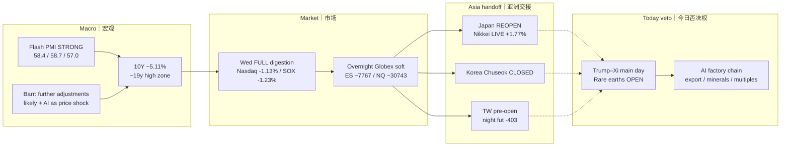

# Transmission Chain — Morning 2026-09-24 / 传导链 — 早盘

**As-of:** 2026-09-24 ~08:46 MYT (Asia/Kuala_Lumpur)  
**Dominant theme:** Strong Flash PMI + hawkish Barr → yields spike → AI-multiple compression → soft Globex → Asia holiday divergence → Trump–Xi veto today  
**Claim class:** RELIABLE / CONFIRMED (closes, Barr transcript, PMI secondaries) · Summit substance OPEN  
**Source:** AP; Digital Look/Sharecast; Fed; Yahoo ~08:46 MYT; Master monitor

### Thinking caption / 思维说明
**Observe:** Rates digestion is the overnight spine; Japan strength is local reopen.  
**Why:** Strong activity + hawkish Fed speak reprice WACC for AI duration.  
**Falsifier / next:** Constructive RE communique + 10Y fade would break the bearish transmission into US cash.

**What this means / 这说明什么:** Do not chain Nikkei +1.8% into SOX repair without yields cooperating.
