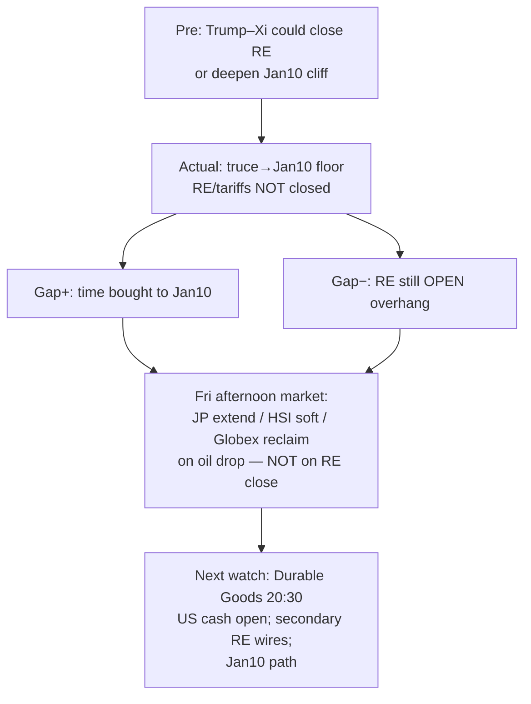

# Expectation Gap — Trump–Xi / Rare Earths lifecycle / 预期差 — 特习/稀土生命周期

**As-of:** 2026-09-25 ~17:25 MYT  
**Event status:** Main day **CLOSED**; truce floor **IN**; RE/tariff package **still OPEN**  
**Claim class:** CONFIRMED (truce→Jan10); RELIABLE (no RE package); INFERENCE (market pricing)

## Pre vs Actual / 预期 vs 实际

| Dimension | Pre-summit / morning frame | Actual (Fri afternoon) | Gap |
|---|---|---|---|
| Truce / 停火 | Extension floor | Extended to **Jan 10 2027** | **Floor delivered** — unchanged |
| Rare earths / 稀土 | Possible close language | **No comprehensive package** | **OPEN overhang continues** |
| Tariffs / 关税 | Possible reset | Left for later | **OPEN** |
| Asia confirm / 亚洲确认 | JP/HK/MY would digest RE | **JP EXTEND +1.30%** / **HSI −1.01%** / CN·KR·TW dark | Confirmation **SPLIT** — not uniform risk-on |
| Globex / 期货 | Morning soft digestion | **RECLAIM** ES 7791 / NQ 30952 on oil drop | Reclaim = **oil-driven**, not RE-closed |
| Equity cash / 现金股指 | Soft OPEN cascade risk Thu | Thu FULL repaired; Fri cash **PENDING** | Fri cash still untested |
| Oil / 油价 | Elevated settle Thu | LIVE **dropped ~2%+** | Near-term inflation optics **eased** |

### Thinking caption / 思维说明
1. **Observe:** Floor **in**; RE close **out**; Asia reaction **split**; Globex reclaim **oil-linked**.  
2. **Why it matters:** Do not mis-read JP green or futures reclaim as “RE resolved.”  
3. **Falsifier:** CONFIRMED RE delivery/export-control language **or** explicit breakdown that re-prices Jan10 cliff.

**What this means / 这说明什么:** Expectation gap = **time bought, certainty not bought**. Afternoon tape improved on **oil/Europe/JP**, not on RE close.  
预期差 = **买到时间，未买到确定性**；午后盘面改善来自**油价/欧洲/日经**，而非稀土闭环。
