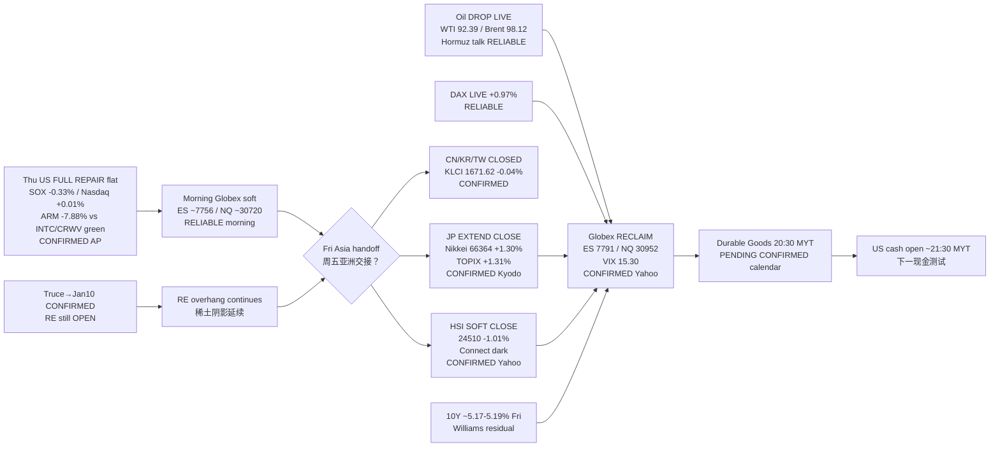

# Transmission Chain — Afternoon 2026-09-25 / 传导链 — 午后

**As-of:** 2026-09-25 ~17:25 MYT  
**Claim class:** ILLUSTRATIVE structure; node facts CONFIRMED/RELIABLE as labeled  
**Dominant theme:** Holiday-thin Asia SPLIT (JP extend / HSI soft) + Globex RECLAIM on oil drop → Durable Goods pending  
**Source:** Yahoo Fri FULL/LIVE ~17:10–17:22 MYT; Kyodo/Sankei Nikkei; CNBC/Bloomberg yields secondary; Morning stamp continuity

### Thinking caption / 思维说明
1. **Observe / 观察:** Morning question “JP fade / Globex soft hold?” → **NO fade — JP EXTENDED; Globex RECLAIMED on oil drop**. HSI sold. RE close? → **still NO**.  
2. **Why it matters / 为何重要:** AI-factory Asia confirmation is **split**; oil ease helped futures but rates/RE still bind; Durable Goods is the next hard print.  
3. **Falsifier / 证伪:** Hot Durable Goods + Globex fade + toxic RE **or** soft Durable Goods + yields ease + RE constructive.

**What this means / 这说明什么:** Dominant theme = **Thu repair → morning soft Globex → Fri JP extend / HSI soft → oil-drop Globex reclaim → Durable Goods → US cash**.
