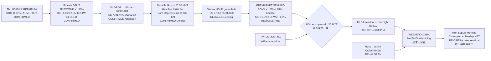

# Transmission Chain — Evening 2026-09-25 / 传导链 — 晚间

**As-of:** 2026-09-25 ~21:12 MYT  
**Claim class:** ILLUSTRATIVE structure; node facts CONFIRMED/RELIABLE as labeled  
**Dominant theme:** Durable Goods flat / core CapEx HOT → Globex HOLD green (fade aft highs) → PRE semi bid → US cash open PENDING → weekend → Mon reopen/Starship  
**Source:** Census CB 26-149; Yahoo chart ~21:09–21:12 MYT; CNBC PRE; Afternoon continuity

### Thinking caption / 思维说明
1. **Observe / 观察:** Afternoon “will Durable Goods break reclaim?” → **NO disorderly break — flat/core-hot; Globex holds green with mild fade; PRE semis bid**.  
2. **Why it matters / 为何重要:** Core CapEx +1.6% supports AI equipment demand optics; rates (~5.18%) still bind multiples; cash open + weekend→Mon are unconfirmed.  
3. **Falsifier / 证伪:** Cash rejects PRE / SOX hard red / 10Y disorderly / toxic RE **or** cash confirms + yields ease + constructive RE.

**What this means / 这说明什么:** Dominant theme = **Durable Goods flat/core-hot → Globex hold → PRE semi bid → cash open → weekend → Mon reopen/Starship/RE**.
